# Reactive Programming in Java & Spring Boot

*English · [Français](GUIDE.fr.md)*

## Table of contents
- [Reactive Programming in Java \& Spring Boot](#reactive-programming-in-java--spring-boot)
  - [Table of contents](#table-of-contents)
  - [1. Introduction](#1-introduction)
  - [2. Threads \& Processes](#2-threads--processes)
    - [2.1 Processes](#21-processes)
    - [2.2 Threads](#22-threads)
      - [2.2.1 Threading models](#221-threading-models)
  - [3. Traditional model vs reactive model](#3-traditional-model-vs-reactive-model)
    - [3.1 The traditional (servlet) model and its limits](#31-the-traditional-servlet-model-and-its-limits)
    - [3.2 Principles of the reactive model](#32-principles-of-the-reactive-model)
  - [4. Reactive programming fundamentals](#4-reactive-programming-fundamentals)
    - [4.1 Reactive Manifesto](#41-reactive-manifesto)
    - [4.2 The Reactive Streams initiative vs. JDK 9](#42-the-reactive-streams-initiative-vs-jdk-9)
    - [4.3 Key concepts (back pressure, event loop, non-blocking I/O)](#43-key-concepts-back-pressure-event-loop-non-blocking-io)
      - [4.3.1 Back pressure](#431-back-pressure)
      - [4.3.2 Event loop](#432-event-loop)
      - [4.3.3 Non-blocking I/O](#433-non-blocking-io)
  - [5. Reactive programming libraries in Java](#5-reactive-programming-libraries-in-java)
    - [5.1 Project Reactor in detail](#51-project-reactor-in-detail)
      - [5.1.1 Reactor Core (Flux vs Mono vs Publisher)](#511-reactor-core-flux-vs-mono-vs-publisher)
      - [5.1.2 Essential operators](#512-essential-operators)
      - [5.1.3 Schedulers.boundedElastic, Schedulers.parallel, subscribeOn \& publishOn](#513-schedulersboundedelastic-schedulersparallel-subscribeon--publishon)
  - [6. Spring WebFlux](#6-spring-webflux)
    - [6.1 Architecture and principles](#61-architecture-and-principles)
      - [6.1.1 EventLoop Thread](#611-eventloop-thread)
      - [6.1.2 Request lifecycle in Spring WebFlux](#612-request-lifecycle-in-spring-webflux)
  - [7. Reactive persistence and messaging: R2DBC and Kafka](#7-reactive-persistence-and-messaging-r2dbc-and-kafka)
    - [7.1 R2DBC principles](#71-r2dbc-principles)
    - [7.2 Integration with Spring Data R2DBC](#72-integration-with-spring-data-r2dbc)
    - [7.3 Reactor Kafka (history)](#73-reactor-kafka-history)
    - [7.4 Kafka with plain Spring Kafka in a reactive application](#74-kafka-with-plain-spring-kafka-in-a-reactive-application)
  - [8. Hands-on POC](#8-hands-on-poc)
  - [8.1 Prerequisites](#81-prerequisites)
  - [8.2 Running the POC](#82-running-the-poc)
  - [8.3 Technologies used](#83-technologies-used)
  - [8.4 Features](#84-features)
    - [8.5 API endpoints](#85-api-endpoints)
      - [Authentication](#authentication)
        - [Sign-up (USER or DRIVER)](#sign-up-user-or-driver)
        - [Login](#login)
      - [Ride management (USER)](#ride-management-user)
        - [Create a ride request](#create-a-ride-request)
        - [Accept a ride offer](#accept-a-ride-offer)
        - [Get ride offers (SSE)](#get-ride-offers-sse)
      - [Ride management (DRIVER)](#ride-management-driver)
        - [See nearby ride requests (SSE)](#see-nearby-ride-requests-sse)
        - [Send a ride offer](#send-a-ride-offer)
    - [8.6 Code examples](#86-code-examples)
      - [8.6.1 Creating a ride request (ride-service)](#861-creating-a-ride-request-ride-service)
      - [8.6.2 Finding nearby rides (driver-service)](#862-finding-nearby-rides-driver-service)
      - [8.6.3 A driver sends an offer (driver-service)](#863-a-driver-sends-an-offer-driver-service)
      - [8.6.4 Accepting an offer (ride-service)](#864-accepting-an-offer-ride-service)
      - [8.6.5 Consuming Kafka events (driver-service)](#865-consuming-kafka-events-driver-service)
  - [9. References](#9-references)

## 1. Introduction

For years, Java web development has relied on servlets, a synchronous, blocking model (thread-per-request). This model quickly becomes inefficient in modern applications and
microservice architectures, which must handle a large number of concurrent requests in real time.
The reactive model emerged to address these constraints. It relies on asynchrony and non-blocking execution, which makes more efficient use of system resources.
This POC compares the traditional model with the reactive approach. It provides a demo based
on [Project Reactor](https://projectreactor.io) and [Spring WebFlux](https://docs.spring.io/spring-framework/reference/web/webflux.html), covering the basics of reactive programming and how to integrate these tools with reactive databases.

## 2. Threads & Processes

Before getting into reactive programming, let's look at how an operating system manages threads of execution.

### 2.1 Processes

A process is a running instance of an executable program. It consists of:
<figure>
  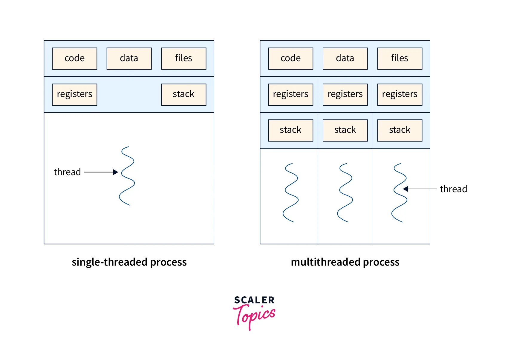
  <figcaption style="text-align: center;"><strong>Process</strong> - source: <a href="https://www.scaler.com/topics/linux-thread/">linux-thread</a></figcaption>
</figure>

- **Code (Text)**: the program's instructions (read-only).
- **Data**: initialized global and static variables.
- **Heap**: memory shared by all threads, used for dynamically allocated objects.
- **Files**: file descriptors opened by the process (files, network sockets, …).
- **Threads**: concurrent units of execution inside the process, sharing the same address space.

### 2.2 Threads

Every process has at least one thread of execution; a thread represents a sub-task.

Each thread has its own:
- **Program Counter (PC)**: pointer to the next instruction to execute.
- **Registers**: CPU registers holding the data being processed.
- **Stack**: private memory holding local variables and function parameters.

There are two kinds of threads:

<figure>
  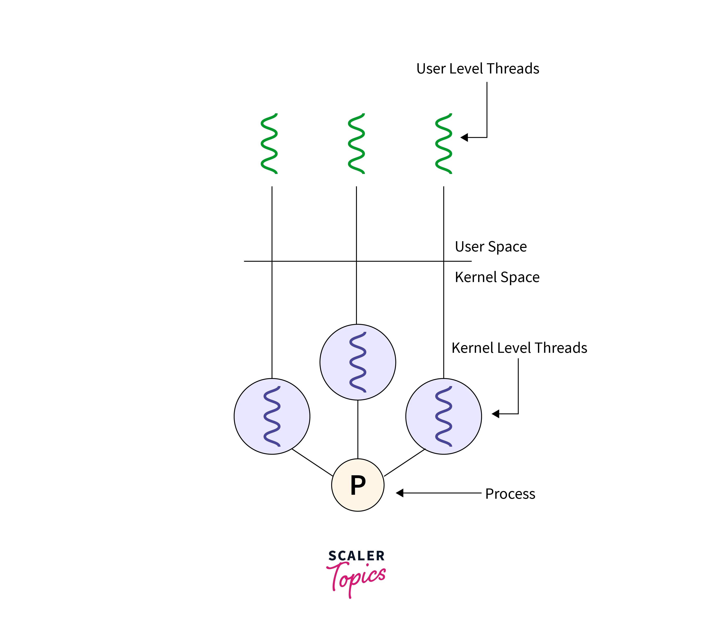
  <figcaption style="text-align: center;"><strong>User-Level thread vs Kernel-Level thread</strong> - source: <a href="https://www.scaler.com/topics/user-level-threads-and-kernel-level-threads/">ult-and-klt</a></figcaption>
</figure>

- **User-level threads (ULT)**: threads created and managed by programs or libraries, for example Java threads, threads created by Python's threading module, or POSIX threads (pthreads) in C/C++.
- **Kernel-level threads (KLT)**: threads created and managed by the operating system kernel. These are the tasks the scheduler actually runs on the CPU.

#### 2.2.1 Threading models

**User-level threads (ULT)** do not run directly on the CPU; they are mapped onto runnable **kernel-level threads (KLT)**.
There are several threading models for mapping ULTs to KLTs:

<figure>
  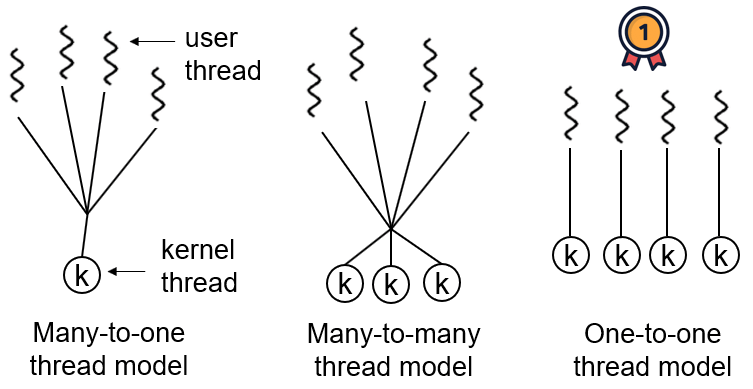
  <figcaption style="text-align: center;"><strong>Threading models</strong> - source: <a href="https://www.researchgate.net/figure/Three-types-of-thread-models-Popular-operating-systems-5-22-24-adopt-the_fig1_346379550">Types of thread models</a></figcaption>
</figure>

- **1:1 model**: each **user thread (ULT)** is mapped to **its own dedicated kernel thread (KLT)**.
- **M:N model**: **M user threads (ULT)** are mapped onto **N kernel threads (KLT)**.
- **M:1 model**: **all user threads of a process** share **a single kernel thread (KLT)**.

**Java** uses the 1:1 model for its classic threads (*platform threads*): each Java thread is bound to a KLT. KLTs are generally expensive to create and to schedule. For example, when a Java thread calls a database (an I/O operation), its KLT stays blocked waiting for the response. During that time the Java thread sits idle, which wastes resources.
This is the problem **reactive programming** sets out to solve, with a non-blocking model that handles I/O efficiently.

> **Note (Java 21)**: since Java 21, *virtual threads* ([JEP 444](https://openjdk.org/jeps/444), Project Loom) bring an M:N model: many virtual threads run on a small number of kernel threads (*carrier threads*). A virtual thread blocked on I/O releases its kernel thread. For I/O-heavy, highly concurrent applications, this is an alternative to reactive programming that keeps plain imperative code (Spring Boot: `spring.threads.virtual.enabled=true`).

## 3. Traditional model vs reactive model

### 3.1 The traditional (servlet) model and its limits

An application built on **the traditional servlet model**, such as a Spring MVC web app running in a servlet container like Tomcat, works as follows.

For each user request, the server:

- Creates a new thread, or more precisely takes one from Tomcat's thread pool, whose size is set by `server.tomcat.threads.max` (200 by default for Spring Boot's embedded Tomcat).
- Assigns that thread to handle the whole request.
- Waits until processing finishes before returning the thread to the pool.

The problem appears when handling a request involves I/O: reading or writing a file, calling an external service (an API, a database, a gRPC microservice, …). The thread then sits blocked, doing nothing, until the I/O completes. Fewer threads remain available in the pool for other requests, which limits how many concurrent connections the application can handle.

This model is simple and good enough for the vast majority of applications. It reaches its limits when the number of concurrent requests far exceeds the pool size and each request spends most of its time waiting on I/O.

<figure>
  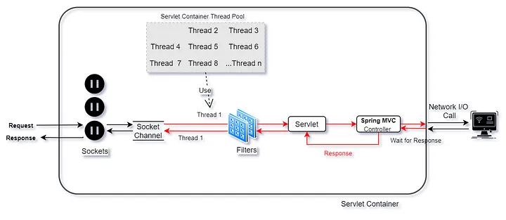
  <figcaption style="text-align: center;"><strong>Spring MVC (servlet model)</strong> - source: <a href="https://singhkaushal.medium.com/spring-webflux-eventloop-vs-thread-per-request-model-a42d07ee8502">Webflux vs Thread per request model</a></figcaption>
</figure>

### 3.2 Principles of the reactive model
The reactive model is built on an **event loop**. Instead of dedicating a thread to each request that then blocks on I/O, it uses a pool with a fixed number of **"event loop threads"**. These threads only pick up work from an **event queue**. When an I/O operation starts, the thread does not wait for the result, because the I/O is non-blocking. It registers a callback that runs later, once the response is ready, and meanwhile the thread is free to handle other requests.

This is the model used by Node.js and by Netty (the default embedded server in
Spring Webflux).

<figure>
  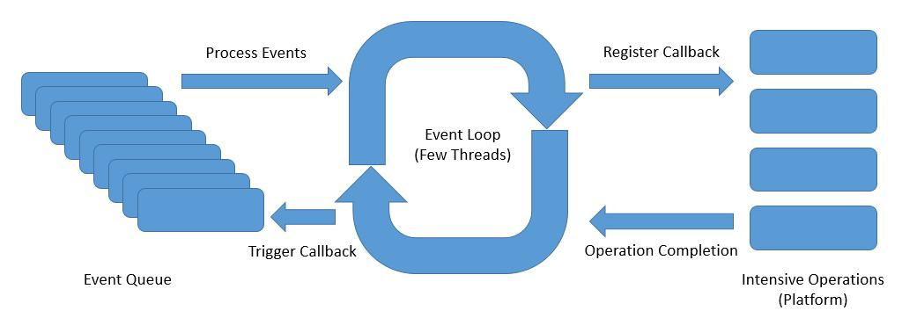
  <figcaption style="text-align: center;"><strong>Event loop model</strong> - source: <a href="https://www.baeldung.com/spring-webflux-concurrency">Concurrency in Spring WebFlux</a></figcaption>
</figure>

**Note**: to avoid blocking the event loop threads, most frameworks and languages built on this model use additional threads called worker threads. These run CPU-heavy work or code from libraries that only offer blocking APIs (such as an old database driver).

## 4. Reactive programming fundamentals

### 4.1 Reactive Manifesto
[The Reactive Manifesto](https://www.reactivemanifesto.org/) defines a reactive system as a distributed system with four properties:
<figure>
  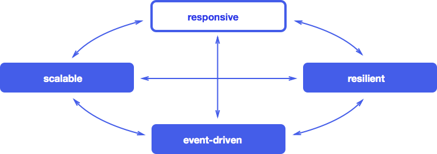
  <figcaption style="text-align: center;"><strong>Properties of a reactive system</strong> - source: <a href="https://www.reactivemanifesto.org/">Reactive Manifesto</a></figcaption>
</figure>

1. **Responsive**: it responds in a timely manner whenever possible.
2. **Elastic**: it stays responsive under varying load.
3. **Resilient**: it stays responsive in the face of failure.
4. **Message driven**: it relies on asynchronous message passing
   between components to ensure loose coupling,
   isolation, location transparency, and
   delegation of errors to other components.

### 4.2 The Reactive Streams initiative vs. JDK 9

[Reactive Streams](https://www.reactive-streams.org/) is a specification for asynchronous stream processing, aimed mainly at the Java ecosystem. Several reactive libraries adopted it, including RxJava 2 and Reactor. With Java 9, its interfaces (`Publisher`, `Subscriber`, `Subscription`, `Processor`) were added to the JDK in `java.util.concurrent.Flow`, with the same semantics.

**However, most libraries kept using `Reactive Streams` to stay compatible with Java 8.**

**Core Reactive Streams interfaces:**

* **`Publisher<T>`:** a source of asynchronous data. It produces elements and sends them to one or more `Subscriber`s. It has a single method:
   ```java
   public interface Publisher<T> {     
       public void subscribe(Subscriber<? super T> s);
   }
   ```
A `Subscriber` calls this method to start receiving elements.

* **`Subscriber<T>`:** a consumer of the data emitted by a `Publisher`. It defines the callbacks that react to stream events:
   ```java
   public interface Subscriber<T> {     
       public void onSubscribe(Subscription s);
       public void onNext(T item);
       public void onError(Throwable t);
       public void onComplete();
   }
   ```
   * `onSubscribe(Subscription s)`: called on subscription, with a `Subscription` object used to control the flow.
   * `onNext(T item)`: called for each element the `Publisher` emits.
   * `onError(Throwable t)`: called if the `Publisher` terminates with an error.
   * `onComplete()`: called if the `Publisher` completes successfully.

* **`Subscription`:** the link between a `Subscriber` and a `Publisher`. It lets the `Subscriber` control how much data it receives, through two methods used for back pressure:
   ```java
   public interface Subscription {
     public void request(long n);
     public void cancel();
   }
   ```
   * `request(long n)`: asks the `Publisher` to emit at most `n` more elements. This is the core back-pressure mechanism.
   * `cancel()`: cancels the subscription; the `Subscriber` no longer wants elements.

* **`Processor<T, R>`:** a component that is both a `Subscriber<T>` and a `Publisher<R>`. It receives elements, processes them and publishes the result, which is useful for intermediate steps in a pipeline. The `Processor` interface extends both:
    ```java
    public interface Processor<T, R> extends Subscriber<T>, Publisher<R> {
    }
    ```
  
### 4.3 Key concepts (back pressure, event loop, non-blocking I/O)
#### 4.3.1 Back pressure
<figure>
  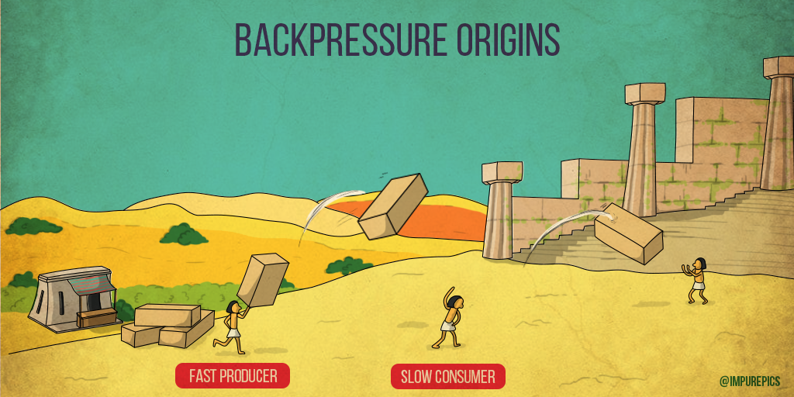
  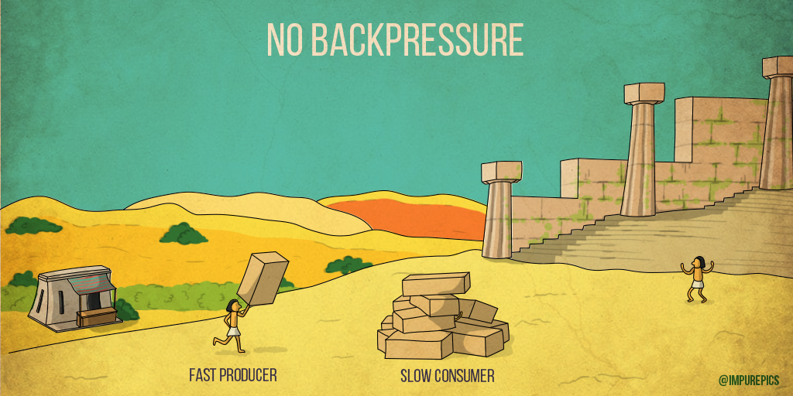
  <figcaption style="text-align: center;"><strong>Origins of back pressure</strong> - source: <a href="https://impurepics.com/posts/2018-05-26-backpressure-origins.html" target="_blank" rel="noopener noreferrer">Back Pressure</a></figcaption>
</figure>

**Back pressure** is a key mechanism in reactive programming: it lets a consumer tell the producer that it is overwhelmed and cannot keep up with the rate of emission. Without it, a fast producer can swamp a slow consumer, causing excessive memory use or data loss.

#### 4.3.2 Event loop
An **event loop** is a non-blocking asynchronous model in which a single thread runs a loop that processes events. Instead of waiting for I/O to finish, the thread starts the operation and moves on. When a result is available, an event fires and the thread runs the associated handler (callback). Because the thread never blocks, the system stays highly responsive.

#### 4.3.3 Non-blocking I/O
**Non-blocking I/O** lets a thread start an input or output operation without waiting for it to complete. The thread carries on with other work and is notified when the operation finishes. Unlike blocking I/O, this lets a small number of threads handle many concurrent operations, which improves throughput and responsiveness.


## 5. Reactive programming libraries in Java

Several Java libraries support the reactive paradigm. The most notable are:

* **[Project Reactor](https://projectreactor.io/):** originally developed by Pivotal (then VMware, now Broadcom), Reactor implements the **Reactive Streams** specification. It provides the core types **Flux** (sequences of 0 to N elements) and **Mono** (0 or 1 element), with a focus on back pressure and a rich set of operators for asynchronous, non-blocking stream processing. Reactor is the reactive foundation of Spring WebFlux, and the subject of this POC together with **Spring WebFlux**.

* **[RxJava](https://github.com/ReactiveX/RxJava):** a mature library following the **[ReactiveX](https://reactivex.io/)** model. It offers `Observable` (no back pressure) and `Flowable` (with back pressure, Reactive Streams-compliant).

* **[Mutiny](https://smallrye.io/smallrye-mutiny/2.4.0/):** developed by Red Hat, Mutiny offers an event-driven, readable reactive API for Java and Kotlin, with **Multi** for streams and **Uni** for single results.

### 5.1 Project Reactor in detail
#### 5.1.1 Reactor Core (Flux vs Mono vs Publisher)
At the heart of **Project Reactor** and the **Reactive Streams** specification is the `Publisher<T>` interface ([see Reactive Streams vs. JDK 9](#42-the-reactive-streams-initiative-vs-jdk-9)).
As described above, `Publisher<T>` is the fundamental Reactive Streams interface: a source of asynchronous data. Project Reactor provides two main implementations: `Flux` and `Mono`.

* **`Flux<T>`:** a `Publisher` that emits a sequence of **0 to n** elements. It represents a stream that can carry several elements, whether they arrive continuously (**stream of events**) or at the end of an operation.

   ```java
    Flux<String> items = Flux.just("Reda", "Java", "Golang", "ILI");
    items.subscribe(item -> System.out.println("item: " + item));
  
   // Assume getStockData returns a Flux<StockData>
   Flux<StockData> stockDataFlux = getStockData("GOOGLE");
   ```

* **`Mono<T>`:** also a `Publisher`, but specialized to emit **0 or 1** element. It represents the asynchronous result of an operation that produces zero or one value, such as fetching a single row from a database table.

    ```java
    Mono<String> user = Mono.just("Reda Himmi");
    user.subscribe(u -> System.out.println("User: " + u));

    Mono<Void> op = Mono.empty().doOnTerminate(() -> System.out.println("Operation finished."));
    op.subscribe();
    ```

In short: `Publisher` is the interface, `Flux` is the implementation for **0 to n** elements, and `Mono` is the implementation for **0 or 1** element.

Note: **a `Publisher` only starts emitting once a `Subscriber` subscribes to it, through `subscribe()` or `subscribe(Consumer<? super T> consumer)`.**

#### 5.1.2 Essential operators

1. `just()`: creates a `Flux` or `Mono` that emits the given elements, then completes. A simple way to build a static Publisher.
<figure>
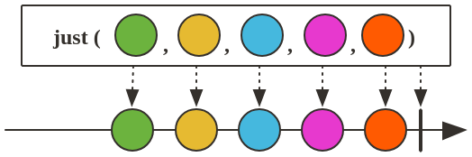
  <figcaption style="text-align: center;"><strong>just()</strong> - source: <a href="https://projectreactor.io/docs/core/release/api/reactor/core/publisher/Flux.html#just-T...-">Flux</a></figcaption>
</figure>

```java
    Flux.just("Hello", "ILI");
    Mono.just("Reda ILI");
```

2. `subscribe()`: attaches a `Subscriber` and triggers emission. This is what activates the stream; it corresponds to calling `subscribe(Subscriber s)` on the Publisher interface.
<figure>
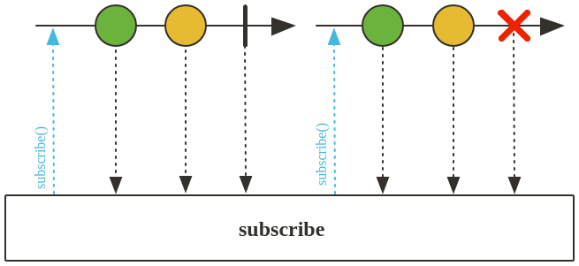
  <figcaption style="text-align: center;"><strong>Subscribe()</strong> - source: <a href="https://projectreactor.io/docs/core/release/api/reactor/core/publisher/Flux.html#subscribe--">Subscribe()</a></figcaption>
</figure>

```java
    Flux.just("a", "b").subscribe(System.out::println);
```

3. `doOnNext(Consumer<? super T> onNext)`: runs a callback for each element the `Publisher` emits, without changing the element.
<figure>
  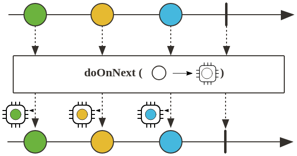
  <figcaption style="text-align: center;"><strong>doOnNext()</strong> - source: <a href="https://projectreactor.io/docs/core/release/api/reactor/core/publisher/Flux.html#doOnNext-java.util.function.Consumer-">doOnNext()</a></figcaption>
</figure>

```java
    Flux.just("Reda", "Himmi")
        .doOnNext(item -> System.out.println("Processing: " + item))
        .subscribe(System.out::println);
```
4. `map(Function<? super T, ? extends R> mapper)`: transforms each emitted element with a synchronous function.
<figure>
  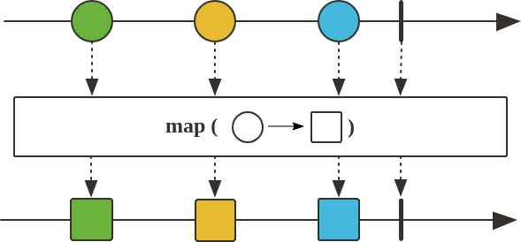
  <figcaption style="text-align: center;"><strong>map()</strong> - source: <a href="https://projectreactor.io/docs/core/release/api/reactor/core/publisher/Flux.html#map-java.util.function.Function-">map()</a></figcaption>
</figure>

```java
    Flux.just("ili", "reda")
        .map(String::toUpperCase)
        .subscribe(System.out::println);
```

5. `filter(Predicate<? super T> predicate)`: emits only the elements that match a predicate.
<figure>
  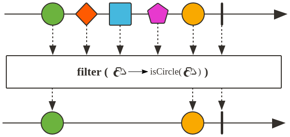
  <figcaption style="text-align: center;"><strong>filter()</strong> - source: <a href="https://projectreactor.io/docs/core/release/api/reactor/core/publisher/Flux.html#filter-java.util.function.Predicate-">filter()</a></figcaption>
</figure>

```java
    Flux.range(1, 5)
        .filter(n -> n % 2 == 0)
        .subscribe(System.out::println);
```

6. `flatMap(Function<? super T, ? extends Publisher<? extends V>> mapper)`: maps each element to a `Publisher` and merges the resulting streams. Ordering is not guaranteed.
<figure>
  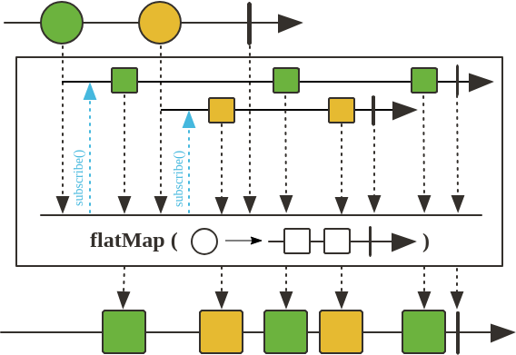
  <figcaption style="text-align: center;"><strong>flatMap()</strong> - source: <a href="https://projectreactor.io/docs/core/release/api/reactor/core/publisher/Flux.html#flatMap-java.util.function.Function-">flatMap()</a></figcaption>
</figure>

```java
Flux.just(1, 2)
    .flatMap(x -> Mono.just("value " + x))
    .subscribe(System.out::println);
```

7. `concatMap(Function<? super T, ? extends Publisher<? extends V>> mapper)`: like `flatMap`, but guarantees that the inner `Publisher`s' elements are emitted in the order of the source stream.
<figure>
  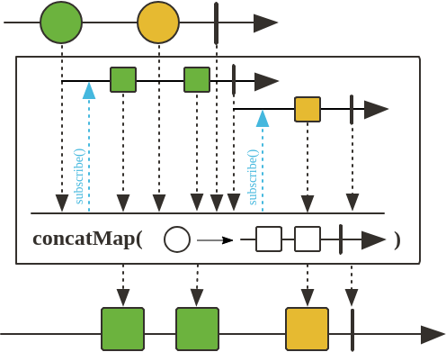
  <figcaption style="text-align: center;"><strong>concatMap()</strong> - source: <a href="https://projectreactor.io/docs/core/release/api/reactor/core/publisher/Flux.html#concatMap-java.util.function.Function-">concatMap()</a></figcaption>
</figure>

```java
Flux.just(1, 2)
    .concatMap(x -> Mono.just("value " + x)
    .delayElement(java.time.Duration.ofMillis(100 * x)))
    .subscribe(System.out::println); // prints "value 1" then "value 2"
```

8. `delayElements(Duration period)`: adds a delay before each element is emitted.
<figure>
  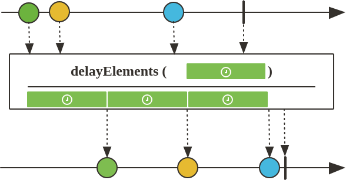
  <figcaption style="text-align: center;"><strong>delayElements()</strong> - source: <a href="https://projectreactor.io/docs/core/release/api/reactor/core/publisher/Flux.html#delayElements-java.time.Duration-">delayElements()</a></figcaption>
</figure>

```java
    Flux.just("one", "two")
        .delayElements(java.time.Duration.ofSeconds(1))
        .subscribe(System.out::println);
```

9. `take(long n)`: emits only the first n elements, then completes.
<figure>
  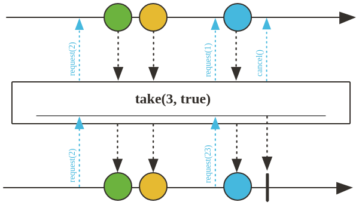
  <figcaption style="text-align: center;"><strong>take()</strong> - source: <a href="https://projectreactor.io/docs/core/release/api/reactor/core/publisher/Flux.html#take-long-">take()</a></figcaption>
</figure>

```java
    Flux.range(1, 10)
        .take(3)
        .subscribe(System.out::println);
```

10. `interval(Duration period)`: creates a Flux that emits Longs at a fixed interval.
<figure>
  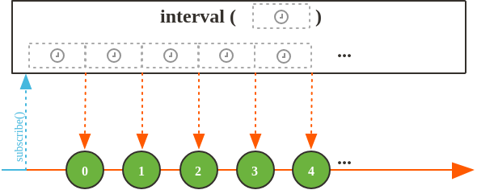
  <figcaption style="text-align: center;"><strong>interval()</strong> - source: <a href="https://projectreactor.io/docs/core/release/api/reactor/core/publisher/Flux.html#interval-java.time.Duration-">interval()</a></figcaption>
</figure>

```java
    Flux.interval(java.time.Duration.ofMillis(300))
        .take(5)
        .subscribe(System.out::println);
    // Output: 0, 1, 2, 3, 4 (one element every 300 ms)
```

11. `zipWith(Publisher<? extends T2> source2)`: pairs the elements of this Flux (or Mono) with those of another Publisher, emitting each pair as a Tuple2.
<figure>
  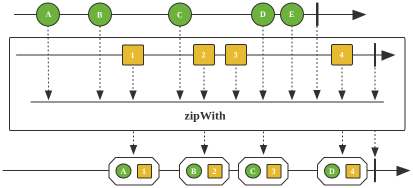
  <figcaption style="text-align: center;"><strong>zipWith()</strong> - source: <a href="https://projectreactor.io/docs/core/release/api/reactor/core/publisher/Flux.html#zipWith-org.reactivestreams.Publisher-">zipWith()</a></figcaption>
</figure>

```java
    Flux<String> letters = Flux.just("a", "b", "c");
    Flux<Integer> numbers = Flux.just(1, 2, 3);

    letters.zipWith(numbers)
           .subscribe(tuple -> System.out.println("Tuple: " + tuple));
        // Output: Tuple2{t1=a, t2=1}
        //         Tuple2{t1=b, t2=2}
        //         Tuple2{t1=c, t2=3}

    // With a combinator function:
    letters.zipWith(numbers, (l, n) -> l + n)
           .subscribe(System.out::println);
        // Output: a1
        //         b2
        //         c3
```

12. `doOnSubscribe(Consumer<? super Subscription> onSubscribe)`: runs an action when the subscription happens. The `Subscription` is the object passed to the `Subscriber` in its `onSubscribe` call.
<figure>
  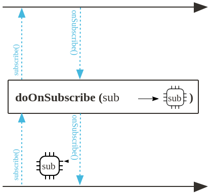
  <figcaption style="text-align: center;"><strong>doOnSubscribe()</strong> - source: <a href="https://projectreactor.io/docs/core/release/api/reactor/core/publisher/Mono.html#doOnSubscribe-java.util.function.Consumer-">doOnSubscribe()</a></figcaption>
</figure>

```java
    Flux.just("start")
        .doOnSubscribe(sub -> System.out.println("Subscribed!"))
        .subscribe(System.out::println);
```

13. `doOnComplete(Runnable onComplete)`: runs an action when the `Publisher` completes successfully (the `Subscriber`'s `onComplete()` call).
<figure>
  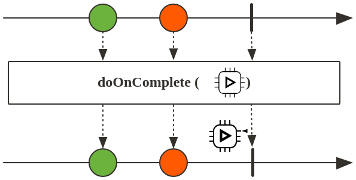
  <figcaption style="text-align: center;"><strong>doOnComplete()</strong> - source: <a href="https://projectreactor.io/docs/core/release/api/reactor/core/publisher/Flux.html#doOnComplete-java.lang.Runnable-">doOnComplete()</a></figcaption>
</figure>

```java
    Flux.just("done")
        .doOnComplete(() -> System.out.println("Flux completed")) // Mono has no doOnComplete: use doOnSuccess
        .subscribe(System.out::println);
```

14. `doOnError(Consumer<? super Throwable> onError)`: runs an action when an error occurs (the `Subscriber`'s `onError(Throwable t)` call).
<figure>
  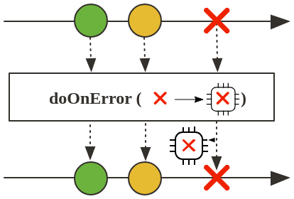
  <figcaption style="text-align: center;"><strong>doOnError()</strong> - source: <a href="https://projectreactor.io/docs/core/release/api/reactor/core/publisher/Flux.html#doOnError-java.util.function.Consumer-">doOnError()</a></figcaption>
</figure>

```java
    Flux.error(new RuntimeException("Something went wrong"))
        .doOnError(e -> System.err.println("Error caught!"))
        .subscribe(null, System.err::println);
```

#### 5.1.3 Schedulers.boundedElastic, Schedulers.parallel, subscribeOn & publishOn

In **Reactor**, **Schedulers** control asynchronous execution and help avoid blocking threads. They decide which threads the operations of a reactive stream run on.

* **`Schedulers.boundedElastic()`**: for potentially blocking work (reading a file, calling a synchronous blocking API). It provides an elastic thread pool with an upper bound.

* **`Schedulers.parallel()`**: tuned for non-blocking, **CPU-intensive** work that parallelizes well (heavy computation). It uses a fixed number of threads.

To use these schedulers, **Reactor** provides two key operators: **`subscribeOn(Scheduler s)`** and **`publishOn(Scheduler s)`**.

* `subscribeOn(Scheduler s)`: sets the `Scheduler` the stream runs on, starting from the source. Only one subscribeOn takes effect (the one closest to the source).
```java
    Mono.fromCallable(() -> "Blocking Task")
        .subscribeOn(Schedulers.boundedElastic()) // the task runs on a boundedElastic thread
        .map(String::toUpperCase)
        .subscribe(result -> System.out.println("Result on: " + Thread.currentThread().getName() + ", " + result));
```

* `publishOn(Scheduler s)`: sets the `Scheduler` for the operators that follow it. You can use it several times to switch execution context at different points.
```java
    Flux.range(1, 3)
        .map(i -> "Step 1 on: " + Thread.currentThread().getName())
        .publishOn(Schedulers.parallel()) // the next step runs on a parallel thread
        .map(s -> "Step 2 on: " + Thread.currentThread().getName() + ", " + s.toUpperCase())
        .subscribe(System.out::println);
```


## 6. Spring WebFlux
[Spring WebFlux](https://docs.spring.io/spring-framework/reference/web/webflux.html) is Spring's non-blocking reactive web framework. **Built on Project Reactor**, it is used to build reactive, scalable web applications on top of the Reactive Streams API. Unlike Spring MVC, which relies on the blocking servlet model, WebFlux is asynchronous and non-blocking by design.

### 6.1 Architecture and principles
WebFlux's reactive design shapes both its threading model and the request lifecycle. Since the Spring Boot WebFlux starter ships Netty as the default embedded server, this section focuses on Netty.

#### 6.1.1 EventLoop thread

An **EventLoop** is a single, non-blocking **thread** managed by **Netty**; it is the building block of the **non-blocking I/O** model used by **Spring WebFlux**. Instead of waiting on I/O, it continuously watches many socket channels (**SocketChannels**) for events. When an event occurs, the **EventLoop** hands it to a handler in the channel pipeline. This lets a small number of threads serve a large number of connections. By default, Reactor Netty creates a group of event loops sized to the number of CPU cores (minimum 4). Never block an **EventLoop**: every connection it serves would stall.

#### 6.1.2 Request lifecycle in Spring WebFlux

<figure>
  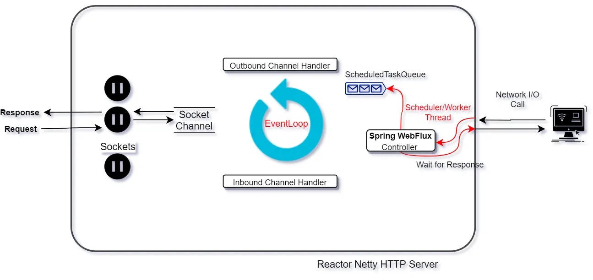
  <figcaption style="text-align: center;"><strong>Spring Webflux Threading Model</strong> - source: <a href="https://singhkaushal.medium.com/spring-webflux-eventloop-vs-thread-per-request-model-a42d07ee8502/">Spring Webflux</a></figcaption>
</figure>

1. **Request -> Socket Channel**: an HTTP request arrives on a **Socket Channel** managed by Netty.
2. **Inbound Channel Handler -> EventLoop (Netty thread)**: the request goes through the **Inbound Channel Handler** and is handed to a Netty **EventLoop** thread.
3. **EventLoop -> Scheduler/Worker Thread**: WebFlux does not offload anything automatically. If the code must call a blocking API, the developer has to move that call to a dedicated **Scheduler** (e.g. `subscribeOn(Schedulers.boundedElastic())`). Non-blocking work stays on the EventLoop.
4. **Scheduler/Worker Thread -> Spring WebFlux Controller/Service**: the **worker thread** runs the potentially blocking code.
5. **Scheduler/Worker Thread -> ScheduledTaskQueue**: once the blocking work is done and the result is ready, the worker thread submits a task carrying the response to the event loop's queue (labelled `ScheduledTaskQueue` in the diagram).
6. **EventLoop -> ScheduledTaskQueue**: the **EventLoop** picks up pending tasks from its queue.
7. **EventLoop -> Outbound Channel Handler -> Socket Channel -> Response**: the **EventLoop** takes the response task, passes it through the **Outbound Channel Handler**, and writes it to the client through the **Socket Channel** without blocking.

This is how **Spring WebFlux** handles many concurrent requests with a limited number of threads.

> **Note**: the diagram says *ScheduledTaskQueue*. In Netty, a task submitted from another thread actually goes through the event loop's regular task queue; the *scheduled task queue* is for delayed tasks (timers).

## 7. Reactive persistence and messaging: R2DBC and Kafka
For an application to be truly reactive, the whole path must be: from the user's request to the server, down to writing to the database and talking to other services such as Kafka. That is why reactive tools exist for each layer, such as R2DBC for databases and Reactor Kafka (or Spring Kafka's reactive support) for messaging. They work with Spring WebFlux and Project Reactor so the application stays reactive end to end.

### 7.1 R2DBC principles
[R2DBC](https://r2dbc.io/) (Reactive Relational Database Connectivity) is a specification for reactive, non-blocking access to relational databases on the JVM. It overcomes JDBC's limits in reactive environments by offering an asynchronous, non-blocking API. With PostgreSQL and Spring WebFlux, the R2DBC PostgreSQL driver (`org.postgresql:r2dbc-postgresql`, formerly `io.r2dbc:r2dbc-postgresql`) keeps the stack reactive end to end.

### 7.2 Integration with Spring Data R2DBC
**[Spring Data R2DBC](https://spring.io/projects/spring-data-r2dbc)** greatly simplifies reactive access to **PostgreSQL** (or other supported relational databases) in a **Spring WebFlux** application. It adds an abstraction layer on top of the native **R2DBC** API.

* Code example (Spring Data R2DBC with PostgreSQL):

```java
import org.springframework.data.annotation.Id;
import org.springframework.data.relational.core.mapping.Table;

@Table("users")
public class User {
    @Id
    private Integer id;
    private String name;
    private Integer age;

    // Constructors, getters and setters
}
```

```java
import org.springframework.data.r2dbc.repository.ReactiveCrudRepository;
import org.springframework.data.r2dbc.repository.Query;
import reactor.core.publisher.Flux;
import reactor.core.publisher.Mono;

public interface UserRepository extends ReactiveCrudRepository<User, Integer> {
    Mono<User> findByName(String name);
    Flux<User> findByAgeGreaterThan(int age);

    @Query("SELECT * FROM users WHERE name LIKE $1")
    Flux<User> findByNameLike(String pattern);
}
```

```java
import org.springframework.stereotype.Service;
import reactor.core.publisher.Flux;
import reactor.core.publisher.Mono;

@Service
public class UserService {

    private final UserRepository userRepository;

    public UserService(UserRepository userRepository) {
        this.userRepository = userRepository;
    }

    public Mono<User> getUserByName(String name) {
        return userRepository.findByName(name);
    }

    public Flux<User> getAdultUsers() {
        return userRepository.findByAgeGreaterThan(17);
    }

    public Flux<User> searchUsersByName(String query) {
        return userRepository.findByNameLike("%" + query + "%");
    }

    public Mono<User> createUser(User user) {
        return userRepository.save(user);
    }

    public Mono<Void> deleteUser(Integer id) {
        return userRepository.deleteById(id);
    }

    public Flux<User> getAllUsers() {
        return userRepository.findAll();
    }
}
```

### 7.3 Reactor Kafka (history)
[Reactor Kafka](https://projectreactor.io/docs/kafka/release/reference/) was a reactive library for [Apache Kafka](https://kafka.apache.org/) built on Project Reactor: `KafkaReceiver` and `KafkaSender` exposed topics as `Flux` and sends as `Mono`, and Spring Kafka wrapped them in `ReactiveKafkaConsumerTemplate` / `ReactiveKafkaProducerTemplate`.

> **May 2025**: the Reactor Kafka project was discontinued, and Spring Kafka's reactive templates are deprecated and will be removed ([announcement](https://spring.io/blog/2025/05/20/reactor-kafka-discontinued)). This POC used them at first and has since **migrated to plain Spring Kafka** (next section). The reactive model stays the same: everything a service does with Kafka is still a `Mono`.

### 7.4 Kafka with plain Spring Kafka in a reactive application
**[Spring for Apache Kafka](https://docs.spring.io/spring-kafka/reference/)** gives a `KafkaTemplate` to produce and `@KafkaListener` to consume. Two small bridges keep them reactive.

**Producing: `KafkaTemplate` + `Mono.fromFuture`**

```java
@Component
@RequiredArgsConstructor
public class EventPublisher {
    private final KafkaTemplate<String, SpecificRecord> kafkaTemplate;

    public Mono<Void> publish(String topic, String key, SpecificRecord event) {
        return Mono.fromFuture(() -> kafkaTemplate.send(topic, key, event)) // lazy: sends on subscribe
                .subscribeOn(Schedulers.boundedElastic())                   // send() may block on metadata
                .then();                                                    // completes on the broker ack
    }
}
```

* `Mono.fromFuture(() -> ...)` (supplier form) is lazy: nothing is sent until the `Mono` is subscribed, and a retry sends again. `Mono.fromFuture(kafkaTemplate.send(...))` would send immediately, at assembly time.
* `send()` can block for up to `max.block.ms` while it fetches metadata (for example when Kafka is unreachable). `subscribeOn(boundedElastic)` keeps that off the Netty event loop.
* Serializers are plain configuration (`spring.kafka.producer.*`): `StringSerializer` for keys, `KafkaAvroSerializer` for values, `acks=all`, idempotence on.

**Consuming: `@KafkaListener` methods returning `Mono<Void>`**

```java
@KafkaListener(topics = "${kafka.topics.ride-proposal-accepted}")
public Mono<Void> onRideProposalAccepted(ConsumerRecord<String, RideProposalAcceptedEvent> record) {
    return resilientRecordProcessor.process(record, () -> /* reactive work, e.g. load, save, publish */ ...);
}
```

Since Spring Kafka 3.2, a listener can return a `Mono` (async listener): the container switches to manual acknowledgment and commits the offset only when the `Mono` completes. Records are no longer pulled through a long-lived `Flux` that one error could terminate.

**Failures: retries, dead-letter topics, poison records**

* **Poison records** (bytes that can't be deserialized): `ErrorHandlingDeserializer` wraps the String/Avro deserializers and turns the failure into a `DeserializationException` *before* the listener runs. The container's `DefaultErrorHandler` treats it as not retryable and its `DeadLetterPublishingRecoverer` publishes the original bytes to `<topic>.DLT`.
* **Failures inside the listener's `Mono`** (database down, missing request or offer...): in Spring Kafka 3.3, a failed async result only reaches the container error handler for `@RetryableTopic` listeners; otherwise it is logged and the record acknowledged. So `ResilientRecordProcessor` retries inside the pipeline (`Retry.backoff`, exponential, `app.kafka.retry.*`) and, when retries are exhausted, hands the record to the **same** `DeadLetterPublishingRecoverer`.
* Either way the `Mono` completes, the offset is committed and the next record is processed: one bad record never stops consumption, and nothing is skipped silently (an event about an unknown request or offer is logged, retried, then dead-lettered).
* Trade-off: an async listener does not wait for one record before starting the next, so records of a partition can be processed out of order (and a retried record is overtaken). Consumers must therefore be idempotent and tolerate reordering.

## 8. Hands-on POC

## 8.1 Prerequisites

1.  Docker with Compose v2 and Buildx
2.  Java 21 & Maven (only to run the tests or a service outside Docker)

## 8.2 Running the POC

See [Running it locally](README.md#running-it-locally) in the README: copy `.env`, set `JWT_SECRET`, run `docker compose up --build`, then `scripts/smoke-test.sh` (from the repository root or `spring-webflux-poc/`). It also explains how to run a single service from your IDE.

## 8.3 Technologies used

1.  [Spring Webflux](https://docs.spring.io/spring-framework/reference/web/webflux.html)
2.  [Spring Security](https://spring.io/projects/spring-security)
3.  [Spring Cloud Gateway Reactive](https://docs.spring.io/spring-cloud-gateway/reference/spring-cloud-gateway.html)
4.  [Apache Kafka](https://kafka.apache.org/)
5.  [Confluent Schema Registry](https://docs.confluent.io/platform/current/schema-registry/index.html)
6. [Apache Avro](https://avro.apache.org/) as the **serialization** format for Kafka messages.
7. [PostgreSQL](https://www.postgresql.org/) and [Spring Data R2DBC](https://spring.io/projects/spring-data-r2dbc).
8. [MongoDB](https://www.mongodb.com/) and [Spring Data MongoDB Reactive](https://www.baeldung.com/spring-data-mongodb-reactive).
9.  [Spring for Apache Kafka](https://spring.io/projects/spring-kafka): `KafkaTemplate` and `@KafkaListener` methods returning `Mono`, with dead-letter topics

## 8.4 Features

This POC is a small application that demonstrates reactive programming with **Spring WebFlux** and **Reactor**, reactive database access with **Spring Data R2DBC** and **Spring Data MongoDB Reactive**, and messaging with **Spring Kafka**.


* A user signs up as a `USER` or a `DRIVER`, then logs in and receives a **JWT**.

* A user with the `USER` role creates **ride requests**, sees offers from several drivers (`DRIVER`) in real time (via **Server-Sent Events**, SSE), and accepts one.

* A user with the `DRIVER` role sees nearby ride requests in real time (via **Server-Sent Events**) and answers a request with an offer.

The application is split into three **microservices** behind an **API gateway**:

* **auth-service**: handles sign-up and authentication. Uses **PostgreSQL**.
* **ride-service**: creates ride requests, shows drivers' offers and accepts one. Uses **PostgreSQL**.
* **driver-service**: shows ride requests near the driver and sends offers. Uses **MongoDB**.
* **api-gateway**: the POC's entry point; routes requests to the right microservice and handles authorization.
* **common**: a module shared by the microservices, containing the Kafka messages and Avro schemas.

-----

* When a rider (`USER`) creates a ride request, it is sent to `ride-service` (`/api/rides`) and stored in the **PostgreSQL** table `ride_requests` with status `REQUESTED`. It is then published to a **Kafka topic** (`poc-ride-request-requested-v1`) and consumed by `driver-service`, which stores it in the **MongoDB** collection `ride_requests`. Drivers near the rider see the request in real time.
* Drivers (`DRIVER`) send priced offers for the request through `driver-service`'s `/api/rides/proposals` endpoint. Each offer is stored in the **MongoDB** collection `ride_proposals` and published to a **Kafka topic** (`poc-ride-request-proposed-v1`). `ride-service` consumes it and shows it to the rider in real time.
* The rider accepts an offer through `ride-service`'s `/api/rides/{rideRequestId}/accept` endpoint. The request moves to `ACCEPTED` and is published to a **Kafka topic** (`poc-ride-request-accepted-v1`). `driver-service` consumes it, confirms the booking by setting the request to `BOOKED`, and tells `ride-service` the driver is booked by publishing to a **Kafka topic** (`poc-ride-request-booked-v1`). Finally, `ride-service` sets the request to `BOOKED`.

### 8.5 API endpoints

The main API endpoints, with curl examples.

#### Authentication

##### Sign-up (USER or DRIVER)
```bash
curl -X POST http://localhost:8085/api/users \
  -H "Content-Type: application/json" \
  -d '{
    "email": "user@example.com",
    "password": "password123",
    "firstName": "John",
    "lastName": "Doe",
    "role": "USER",
    "phoneNumber": "0612345678"
  }'
```

##### Login
```bash
curl -X POST http://localhost:8085/api/users/auth \
  -H "Content-Type: application/json" \
  -d '{
    "email": "user@example.com",
    "password": "password123",
    "role": "USER"
  }'
```

#### Ride management (USER)

##### Create a ride request
```bash
curl -X POST http://localhost:8085/api/rides \
  -H "Content-Type: application/json" \
  -H "Authorization: Bearer YOUR_JWT_TOKEN" \
  -d '{
    "startLng": 20.2,
    "startLat": 33.2,
    "endLng": 20.1,
    "endLat": 50.1,
    "seats": 2,
    "preferredPrice": 12.22
  }'
```

##### Accept a ride offer
```bash
curl -X PUT http://localhost:8085/api/rides/RIDE_REQUEST_ID/accept \
  -H "Content-Type: application/json" \
  -H "Authorization: Bearer YOUR_JWT_TOKEN" \
  -d '{
    "rideProposalId": "PROPOSAL_ID"
  }'
```

##### Get ride offers (SSE)
```bash
curl -N http://localhost:8085/api/rides/RIDE_REQUEST_ID/proposals/stream \
  -H "Authorization: Bearer YOUR_JWT_TOKEN"
```

#### Ride management (DRIVER)

##### See nearby ride requests (SSE)
```bash
curl -N "http://localhost:8085/api/rides/nearby/stream?lat=33.3&lng=20.2&radius=100" \
  -H "Authorization: Bearer YOUR_JWT_TOKEN"
```

##### Send a ride offer
```bash
curl -X POST http://localhost:8085/api/rides/proposals \
  -H "Content-Type: application/json" \
  -H "Authorization: Bearer YOUR_JWT_TOKEN" \
  -d '{
    "rideRequestId": "RIDE_REQUEST_ID",
    "price": 15.50
  }'
```

**Notes:**
- Replace `YOUR_JWT_TOKEN` with the JWT returned at login.
- SSE (Server-Sent Events) endpoints keep the connection open to push real-time updates.
- Every endpoint except sign-up and login requires a valid JWT.
- User details (ID, role, email, etc.) are read from the JWT.

### 8.6 Code examples

The most important pieces of code behind the application's main features.

#### 8.6.1 Creating a ride request (ride-service)

```java
@Service
@RequiredArgsConstructor
public class RideRequestServiceImpl implements RideRequestService {
    @Transactional
    @Override
    public Mono<CreateRideRequestResponseDto> createRideRequest(CustomerInternalDto customerInternalDto, CreateRideRequestRequestDto requestDto) {
        // 1. Build the ride request entity
        RideRequestEntity rideRequestEntity = rideRequestMapper.mapToRideRequestEntity(requestDto);
        rideRequestEntity.setCustomerId(customerInternalDto.getCustomerId());
        rideRequestEntity.setStatus(RideRequestStatus.REQUESTED);

        // 2. Save to PostgreSQL and publish a Kafka event
        return rideRequestRepository.save(rideRequestEntity)
                .flatMap(rideRequest -> {
                    // Build the Kafka event
                    RideRequestRequestedEvent event = RideRequestRequestedEvent.newBuilder()
                            .setRideRequestId(rideRequest.getRideRequestId().toString())
                            .setCustomerId(rideRequest.getCustomerId().toString())
                            // ... other fields ...
                            .build();

                    // Publish the event
                    return eventPublisher
                            .publish(rideRequestRequestedTopicName, rideRequest.getRideRequestId().toString(), event)
                            .thenReturn(rideRequest);
                })
                .map(rideRequestMapper::mapToCreateRideRequestResponseDto);
    }
}
```

#### 8.6.2 Finding nearby rides (driver-service)

```java
@Service
@RequiredArgsConstructor
public class RideRequestServiceImpl implements RideRequestService {
    @Override
    public Flux<RideRequestEntity> getNearbyRideRequests(DriverInternalDto driverInternalDto, Double lat, Double lng, Integer radiusKm) {
        // 1. Build the driver's location point
        GeoJsonPoint driverPoint = new GeoJsonPoint(lng, lat);
        Distance distance = new Distance(radiusKm, Metrics.KILOMETERS);

        // 2. Find existing requests within the radius
        Flux<RideRequestEntity> nearRides = rideRequestRepository
                .findByStatusAndStartLocationNear(RideRequestStatus.REQUESTED, driverPoint, distance);

        // 3. Watch new requests in real time
        Flux<RideRequestEntity> liveNearbyRides = reactiveMongoTemplate
                .changeStream(RideRequestEntity.class)
                .watchCollection("ride_requests")
                .filter(Criteria.where("status").is(RideRequestStatus.REQUESTED.toString()))
                .listen()
                .mapNotNull(ChangeStreamEvent::getBody)
                .filter(ride -> isWithinRadius(driverPoint, ride.getStartLocation(), radiusKm));

        // 4. Combine both streams
        return Flux.concat(nearRides, liveNearbyRides);
    }
}
```

#### 8.6.3 A driver sends an offer (driver-service)

```java
@Service
@RequiredArgsConstructor
public class RideProposalServiceImpl implements RideProposalService {
    @Transactional
    @Override
    public Mono<ProposeRideProposalResponseDto> proposeRideProposal(DriverInternalDto driverInternalDto, ProposeRideProposalRequestDto requestDto) {
        // 1. Check that the request exists
        return rideRequestRepository.findByRideRequestIdAndStatus(requestDto.getRideRequestId(), RideRequestStatus.REQUESTED)
                .switchIfEmpty(Mono.error(new RideRequestNotFoundException("Ride not found")))
                .flatMap(rideRequest -> {
                    // 2. Build the offer
                    RideProposalEntity proposal = rideProposalMapper.mapToRideProposalEntity(requestDto);
                    proposal.setDriverId(driverInternalDto.getDriverId().toString());
                    proposal.setDriverEmail(driverInternalDto.getDriverEmail());
                    // ... other driver fields ...
                    return rideProposalRepository.save(proposal);
                })
                .flatMap(proposal -> {
                    // 3. Publish the Kafka event
                    RideProposalProposedEvent event = RideProposalProposedEvent.newBuilder()
                            .setRideProposalId(proposal.getRideProposalId())
                            .setRideRequestId(proposal.getRideRequestId())
                            .setPrice(proposal.getPrice())
                            // ... other fields ...
                            .build();
                    return eventPublisher
                            .publish(rideProposalProposedTopicName, proposal.getRideProposalId(), event)
                            .thenReturn(proposal);
                })
                .map(rideProposalMapper::mapToProposeRideProposalResponseDto);
    }
}
```

#### 8.6.4 Accepting an offer (ride-service)

```java
@Service
@RequiredArgsConstructor
public class RideRequestServiceImpl implements RideRequestService {
    @Transactional
    @Override
    public Mono<AcceptRideProposalResponseDto> acceptRideProposal(CustomerInternalDto customerInternalDto, UUID rideRequestId, AcceptRideProposalRequestDto requestDto) {
        // 1. Find and validate the request
        return rideRequestRepository.findByRideRequestIdAndCustomerId(rideRequestId, customerInternalDto.getCustomerId())
                .switchIfEmpty(Mono.error(new RideRequestNotFoundException("Ride Request not found")))
                .<RideRequestEntity>handle((rideRequest, sink) -> {
                    if (rideRequest.getStatus() == RideRequestStatus.REQUESTED) {
                        rideRequest.setStatus(RideRequestStatus.ACCEPTED);
                        sink.next(rideRequest);
                        return;
                    }
                    sink.error(new RideRequestNotFoundException("Ride Request is not in REQUESTED status"));
                })
                // 2. Save and publish the event
                .flatMap(rideRequestRepository::save)
                .flatMap(rideRequest -> {
                    RideProposalAcceptedEvent event = RideProposalAcceptedEvent.newBuilder()
                            .setRideRequestId(rideRequest.getRideRequestId().toString())
                            .setRideProposalId(requestDto.getRideProposalId().toString())
                            .build();
                    return eventPublisher
                            .publish(rideProposalAcceptedTopicName, rideRequest.getRideRequestId().toString(), event)
                            .thenReturn(rideRequest);
                })
                .map(rideRequestMapper::mapToAcceptRideProposalResponseDto);
    }
}
```

#### 8.6.5 Consuming Kafka events (driver-service)

```java
@Component
@RequiredArgsConstructor
public class RideProposalAcceptedEventConsumer {
    private final RideRequestRepository rideRequestRepository;
    private final RideProposalRepository rideProposalRepository;
    private final EventPublisher eventPublisher;
    private final ResilientRecordProcessor resilientRecordProcessor;

    // 1. Async listener: the offset is committed only when the returned Mono completes
    @KafkaListener(topics = "${kafka.topics.ride-proposal-accepted}")
    public Mono<Void> onRideProposalAccepted(ConsumerRecord<String, RideProposalAcceptedEvent> record) {
        RideProposalAcceptedEvent event = record.value();
        String rideRequestId = event.getRideRequestId().toString();
        String rideProposalId = event.getRideProposalId().toString();

        // 2. Retries with backoff, then dead-letter topic: a failure never stops consumption
        return resilientRecordProcessor.process(record, () -> Mono.zip(
                        // 3. Load the request and the offer; a missing one is an error (retried, then DLT)
                        rideRequestRepository.findById(rideRequestId)
                                .switchIfEmpty(Mono.error(() -> new EventTargetNotFoundException("unknown ride request " + rideRequestId))),
                        rideProposalRepository.findById(rideProposalId)
                                .switchIfEmpty(Mono.error(() -> new EventTargetNotFoundException("unknown ride proposal " + rideProposalId))))
                .flatMap(tuple -> {
                    RideRequestEntity rideRequest = tuple.getT1();
                    RideProposalEntity rideProposal = tuple.getT2();
                    // 4. Update the request status
                    rideRequest.setStatus(RideRequestStatus.BOOKED);
                    rideRequest.setAcceptedRideProposalId(rideProposal.getRideProposalId());
                    // 5. Save, then publish the booked event; the offset is committed after both
                    return rideRequestRepository.save(rideRequest)
                            .then(eventPublisher.publish(rideProposalBookedTopic, rideProposal.getRideProposalId(),
                                    buildBookedEvent(rideRequest, rideProposal)));
                })
                .then());
    }
}
```

## 9. References
* [Project Reactor](https://projectreactor.io)
* [Spring WebFlux](https://docs.spring.io/spring-framework/reference/web/webflux.html)
* [linux-thread](https://www.scaler.com/topics/linux-thread/)
* [ult-and-klt](https://www.scaler.com/topics/user-level-threads-and-kernel-level-threads/)
* [Types of thread models](https://www.researchgate.net/figure/Three-types-of-thread-models-Popular-operating-systems-5-22-24-adopt-the_fig1_346379550)
* [Webflux vs Thread per request model](https://singhkaushal.medium.com/spring-webflux-eventloop-vs-thread-per-request-model-a42d07ee8502)
* [Concurrency in Spring WebFlux](https://www.baeldung.com/spring-webflux-concurrency)
* [Reactive Manifesto](https://www.reactivemanifesto.org/)
* [Flux (Project Reactor)](https://projectreactor.io/docs/core/release/api/reactor/core/publisher/Flux.html#just-T...-)
* [Subscribe() (Project Reactor)](https://projectreactor.io/docs/core/release/api/reactor/core/publisher/Flux.html#subscribe--)
* [doOnNext() (Project Reactor)](https://projectreactor.io/docs/core/release/api/reactor/core/publisher/Flux.html#doOnNext-java.util.function.Consumer-)
* [map() (Project Reactor)](https://projectreactor.io/docs/core/release/api/reactor/core/publisher/Flux.html#map-java.util.function.Function-)
* [filter() (Project Reactor)](https://projectreactor.io/docs/core/release/api/reactor/core/publisher/Flux.html#filter-java.util.function.Predicate-)
* [flatMap() (Project Reactor)](https://projectreactor.io/docs/core/release/api/reactor/core/publisher/Flux.html#flatMap-java.util.function.Function-)
* [concatMap() (Project Reactor)](https://projectreactor.io/docs/core/release/api/reactor/core/publisher/Flux.html#concatMap-java.util.function.Function-)
* [delayElements() (Project Reactor)](https://projectreactor.io/docs/core/release/api/reactor/core/publisher/Flux.html#delayElements-java.time.Duration-)
* [take() (Project Reactor)](https://projectreactor.io/docs/core/release/api/reactor/core/publisher/Flux.html#take-long-)
* [interval() (Project Reactor)](https://projectreactor.io/docs/core/release/api/reactor/core/publisher/Flux.html#interval-java.time.Duration-)
* [zipWith() (Project Reactor)](https://projectreactor.io/docs/core/release/api/reactor/core/publisher/Flux.html#zipWith-org.reactivestreams.Publisher-)
* [doOnSubscribe() (Project Reactor)](https://projectreactor.io/docs/core/release/api/reactor/core/publisher/Mono.html#doOnSubscribe-java.util.function.Consumer-)
* [doOnComplete() (Project Reactor)](https://projectreactor.io/docs/core/release/api/reactor/core/publisher/Flux.html#doOnComplete-java.lang.Runnable-)
* [doOnError() (Project Reactor)](https://projectreactor.io/docs/core/release/api/reactor/core/publisher/Flux.html#doOnError-java.util.function.Consumer-)
* [R2DBC](https://r2dbc.io/)
* [Spring Data R2DBC](https://spring.io/projects/spring-data-r2dbc)
* [Reactor Kafka](https://projectreactor.io/docs/kafka/release/reference/)
* [Apache Kafka](https://kafka.apache.org/)
* [Spring Kafka](https://docs.spring.io/spring-kafka/reference/)
