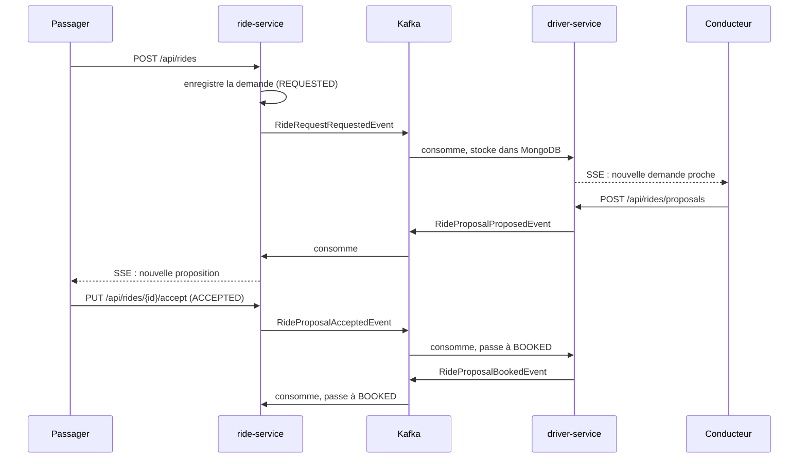

# Reactive Ride-Hailing

[](https://github.com/HIMMIREDA/reactive-ride-hailing/actions/workflows/ci.yml)

*[English](README.md) · Français*

Un backend de VTC entièrement réactif, construit avec Spring WebFlux, Kafka, R2DBC et MongoDB. Un passager publie une demande de course, les conducteurs à proximité la voient en temps réel et proposent un prix, puis le passager voit les propositions en direct et en accepte une.

Je l'ai réalisé pour comparer le modèle « un thread par requête » au modèle réactif. Le guide complet sur la programmation réactive en Java (threads, Reactive Streams, Reactor, fonctionnement interne de WebFlux, R2DBC, Reactor Kafka) se trouve dans [GUIDE.fr.md](GUIDE.fr.md) ([version anglaise](GUIDE.md)).

## Architecture


| Service | Rôle | Stockage |
| --- | --- | --- |
| api-gateway | Point d'entrée unique (port 8085), routage et autorisation | – |
| auth-service | Inscription et connexion, émission des JWT | PostgreSQL (R2DBC) |
| ride-service | Côté passager : créer une demande, suivre les propositions, en accepter une | PostgreSQL (R2DBC) |
| driver-service | Côté conducteur : suivre les demandes proches, proposer un prix | MongoDB (réactif) |
| common | Schémas Avro et classes d'événements partagés entre les services | – |

## Cycle de vie d'une course



## Stack technique

- Java 21, Spring Boot 3.5, Spring WebFlux sur Reactor Netty
- Spring Cloud Gateway (réactif), Spring Security, JWT
- PostgreSQL avec Spring Data R2DBC
- MongoDB avec Spring Data MongoDB Reactive : requêtes géospatiales et change streams
- Apache Kafka (mode KRaft), Confluent Schema Registry, Avro
- Reactor Kafka, via les templates réactifs de Spring Kafka
- Server-Sent Events pour le temps réel
- Docker Compose, AKHQ (interface web Kafka)

## Lancer le projet en local

Pré-requis : Java 21, Maven, Docker avec Docker Compose.

```bash
mvn clean install -U

cd spring-webflux-poc
cp .env.example .env           # puis choisissez votre utilisateur/mot de passe PostgreSQL et JWT_SECRET
docker compose up -d           # PostgreSQL, MongoDB (replica set), Kafka, Schema Registry, AKHQ

cd common
mvn schema-registry:register   # enregistre les schémas Avro ; réessayer après quelques secondes en cas d'échec

# puis lancer chaque service dans son propre terminal
cd ../auth-service   && mvn spring-boot:run
cd ../ride-service   && mvn spring-boot:run
cd ../driver-service && mvn spring-boot:run
cd ../api-gateway    && mvn spring-boot:run
```

Ports locaux : API gateway 8085, AKHQ 9000, Schema Registry 8081, Kafka 9092, PostgreSQL 15432, MongoDB 27017.

Une collection Postman est fournie : `spring-webflux-poc/poc-spring-webflux.postman_collection.json`.

## API

Toutes les requêtes passent par la gateway sur le port 8085. Tous les endpoints, sauf l'inscription et la connexion, exigent un en-tête `Authorization: Bearer <JWT>`.

| Méthode | Chemin | Rôle | Action |
| --- | --- | --- | --- |
| POST | `/api/users` | – | Inscription en tant que USER ou DRIVER |
| POST | `/api/users/auth` | – | Connexion, renvoie un JWT |
| POST | `/api/rides` | USER | Créer une demande de course |
| GET | `/api/rides/{rideRequestId}/proposals/stream` | USER | Flux temps réel (SSE) des propositions des conducteurs |
| PUT | `/api/rides/{rideRequestId}/accept` | USER | Accepter une proposition |
| GET | `/api/rides/nearby/stream?lat=…&lng=…&radius=…` | DRIVER | Flux temps réel (SSE) des demandes proches, rayon en km |
| POST | `/api/rides/proposals` | DRIVER | Proposer un prix |

Exemple : créer une demande de course.

```bash
curl -X POST http://localhost:8085/api/rides -H "Content-Type: application/json" -H "Authorization: Bearer YOUR_JWT_TOKEN" -d '{"startLng": 20.2, "startLat": 33.2, "endLng": 20.1, "endLat": 50.1, "seats": 2, "preferredPrice": 12.22}'
```

D'autres exemples curl sont dans [GUIDE.fr.md, section 8.5](GUIDE.fr.md#85-documentation-des-endpoints-api).

## Choix de conception

- **Réactif de bout en bout.** Un seul appel bloquant sur un EventLoop Netty bloque toutes les connexions gérées par cette boucle. Toutes les I/O passent donc par des drivers non bloquants : R2DBC pour PostgreSQL, le driver MongoDB réactif et Reactor Kafka.
- **Demandes proches = historique + flux en direct.** driver-service renvoie d'abord les demandes existantes via une requête géospatiale, puis suit les nouvelles via un change stream MongoDB, et enchaîne les deux avec `Flux.concat`. Les change streams nécessitent un replica set : c'est pourquoi Docker Compose démarre MongoDB en replica set à un seul nœud.
- **Événements typés.** Les événements Kafka sont des enregistrements Avro déclarés dans le Schema Registry, générés dans le module `common` et partagés par tous les services.
- **Chaque service possède ses données.** ride-service garde la vue passager dans PostgreSQL ; driver-service garde sa propre copie dans MongoDB, qui fournit nativement les requêtes géo et les change streams.
- **La gateway est le seul point d'entrée.** api-gateway vérifie le JWT, supprime les en-têtes d'identité envoyés par le client (`X-User-Id`, `X-Role`, `X-Email`, `X-First-Name`, `X-Last-Name`, `X-Phone-Number`) et les remplit à partir des claims du token. auth-, ride- et driver-service font confiance à ces en-têtes sans rien vérifier : ils ne doivent donc jamais être joignables directement, sinon n'importe qui peut se faire passer pour n'importe quel utilisateur. Gardez-les sur un réseau privé et n'exposez que la gateway.

## TODO

- [ ] **Rendre atomiques les écritures base de données et Kafka.** Les services enregistrent en base puis publient sur Kafka. `@Transactional` ne couvre que la base : un crash ou une erreur Kafka entre les deux étapes fait perdre l'événement. Prévu : le pattern transactional outbox.
- [ ] **Valider l'offset après l'envoi de l'événement suivant.** Dans `RideProposalAcceptedEventConsumer` (driver-service), l'offset est validé avant la publication de l'événement « booked ». Logger aussi les demandes ou propositions introuvables et les envoyer vers un dead-letter topic au lieu de les ignorer silencieusement.
- [ ] **Ajouter une reprise sur erreur au consumer de driver-service.** Il se termine par un `subscribe()` sans gestion d'erreur et `KafkaFluxRegistry` se contente de logger : une seule exception arrête la consommation jusqu'au redémarrage. Prévu : `onErrorResume` ou `retryWhen` par message, plus un dead-letter topic.
- [ ] **Partager un seul change stream entre les conducteurs.** Chaque connexion SSE ouvre son propre change stream MongoDB. Prévu : un flux unique diffusé aux abonnés avec `Sinks.many().multicast()`.
- [ ] **Migrer hors de Reactor Kafka.** Le projet est arrêté depuis mai 2025 et les templates réactifs de Spring Kafka sont dépréciés ([annonce](https://spring.io/blog/2025/05/20/reactor-kafka-discontinued)). Prévu : Spring Kafka classique (`KafkaTemplate`, `@KafkaListener`) relié à `Mono`/`Flux`.
- [x] **Ajouter des tests automatisés.** Tests d'intégration avec Testcontainers (Kafka, PostgreSQL, MongoDB) et `StepVerifier` pour les pipelines réactifs.
- [x] **Renvoyer 409 pour les transitions de statut invalides.** Accepter une demande de course qui n'est plus `REQUESTED` renvoie 409 Conflict au lieu de 404 Not Found.
- [x] **Tester l'authentification de la gateway.** Les tokens absents, malformés, mal signés ou expirés reçoivent 401 ; les tokens valides sont transmis avec les en-têtes d'identité, et les en-têtes d'identité envoyés par le client sont supprimés.
- [x] **Sortir le secret JWT du code.** auth-service et api-gateway le lisent depuis la variable d'environnement `JWT_SECRET` (ou `.env`) et refusent de démarrer s'il est absent ou fait moins de 64 octets.
