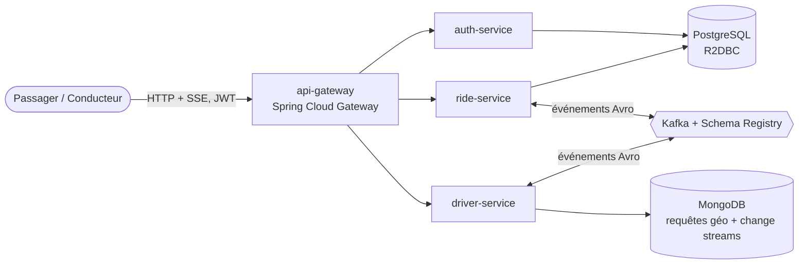
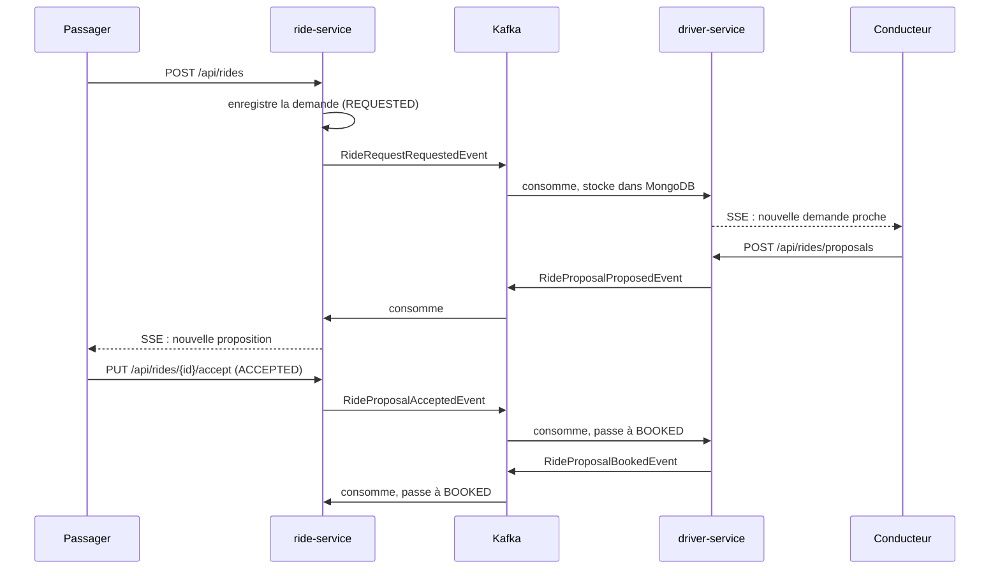
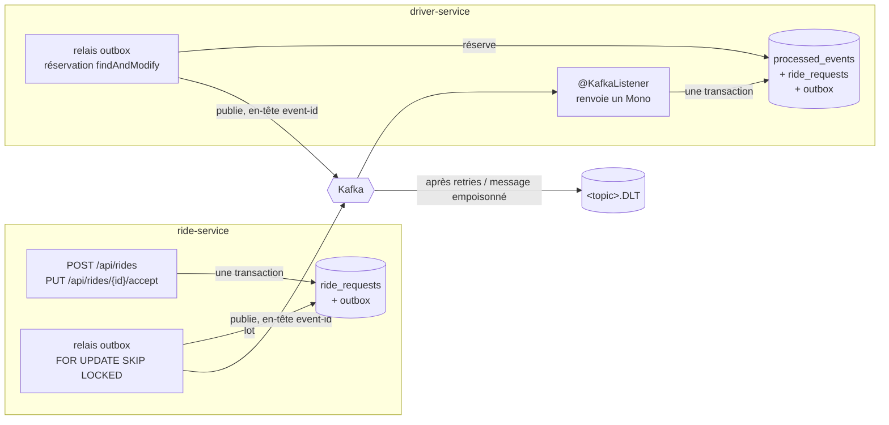

# Reactive Ride-Hailing

[](https://github.com/HIMMIREDA/reactive-ride-hailing/actions/workflows/ci.yml)

*[English](README.md) · Français*

Un backend de VTC entièrement réactif, construit avec Spring WebFlux, Kafka, R2DBC et MongoDB. Un passager publie une demande de course, les conducteurs à proximité la voient en temps réel et proposent un prix, puis le passager voit les propositions en direct et en accepte une.

Je l'ai réalisé pour comparer le modèle « un thread par requête » au modèle réactif. Le guide complet sur la programmation réactive en Java (threads, Reactive Streams, Reactor, fonctionnement interne de WebFlux, R2DBC, Kafka) se trouve dans [GUIDE.fr.md](GUIDE.fr.md) ([version anglaise](GUIDE.md)).

## Architecture



| Service | Rôle | Stockage |
| --- | --- | --- |
| api-gateway | Point d'entrée unique (port 8085), routage et autorisation | – |
| auth-service | Inscription et connexion, émission des JWT | PostgreSQL (R2DBC) |
| ride-service | Côté passager : créer une demande, suivre les propositions, en accepter une | PostgreSQL (R2DBC) |
| driver-service | Côté conducteur : suivre les demandes proches, proposer un prix | MongoDB (réactif) |
| common | Schémas Avro et classes d'événements partagés entre les services | – |

## Cycle de vie d'une course



## Stack technique

- Java 21, Spring Boot 3.5, Spring WebFlux sur Reactor Netty
- Spring Cloud Gateway (réactif), Spring Security, JWT
- PostgreSQL avec Spring Data R2DBC
- MongoDB avec Spring Data MongoDB Reactive : requêtes géospatiales et change streams
- Apache Kafka (mode KRaft), Confluent Schema Registry, Avro
- Spring Kafka : `KafkaTemplate` et méthodes `@KafkaListener` qui renvoient un `Mono`, avec retries et dead-letter topics
- Server-Sent Events pour le temps réel
- Docker Compose, AKHQ (interface web Kafka)

## Lancer le projet en local

Pré-requis : Docker avec Compose v2 et Buildx (tous deux inclus dans Docker Desktop et dans les paquets docker-ce ; sur certaines distributions Linux, Buildx est un paquet séparé, par exemple `docker-buildx`). Java 21 et Maven ne servent qu'à lancer les tests ou un service hors de Docker.

```bash
cd spring-webflux-poc
cp .env.example .env
# renseignez JWT_SECRET dans .env (et les identifiants PostgreSQL si vous le souhaitez) :
#   JWT_SECRET=$(openssl rand -base64 64 | tr -d '\n')
docker compose up --build      # ou : docker compose up -d --build --wait
```

Compose construit les images des quatre services, démarre PostgreSQL, MongoDB (replica set), Kafka, Schema Registry et AKHQ, enregistre les schémas Avro (conteneur ponctuel `schema-init`) et ne démarre chaque service qu'une fois ses dépendances en bonne santé. Le premier build télécharge les dépendances Maven ; les suivants réutilisent un cache BuildKit.

Une fois tout en bonne santé, lancez le test de bout en bout depuis la racine du dépôt (nécessite `curl` et `jq`). Il inscrit un passager et un conducteur, crée une course, envoie et accepte une proposition, et vérifie que la course finit `BOOKED` :

```bash
scripts/smoke-test.sh            # depuis la racine du dépôt
../scripts/smoke-test.sh         # ou depuis spring-webflux-poc/
```

Ports publiés : API gateway http://localhost:8085 et AKHQ http://localhost:9000. Rien d'autre n'est joignable depuis la machine hôte (voir [Choix de conception](#choix-de-conception)). Pour accéder directement à une base, à Kafka, au Schema Registry ou à un service pendant le débogage, copiez `spring-webflux-poc/docker-compose.override.example.yml` en `docker-compose.override.yml` (ignoré par git) ; le fichier explique ce qu'il ouvre.

### Lancer un service depuis l'IDE

1. `cp docker-compose.override.example.yml docker-compose.override.yml`, puis `docker compose up -d` (publie les ports d'infrastructure utilisés par défaut par les services).
2. `docker compose stop ride-service` (le service sur lequel vous travaillez).
3. Lancez-le depuis l'IDE ou avec `mvn spring-boot:run` dans son module, sans le profil `docker` : il utilise `localhost` et lit `spring-webflux-poc/.env`.

La gateway en conteneur route toujours vers le conteneur `ride-service`. Pour faire passer le trafic par une gateway jusqu'à l'instance de l'IDE, lancez aussi `api-gateway` depuis l'IDE (par défaut, elle pointe vers `localhost:8082`-`8084`).

Une collection Postman est fournie : `spring-webflux-poc/poc-spring-webflux.postman_collection.json`. Lancez les requêtes dans l'ordre : les requêtes de connexion enregistrent les JWT dans les variables de collection `{{jwt}}` (passager) et `{{driverJwt}}` (conducteur), et les requêtes de création et de proposition enregistrent les identifiants utilisés par les suivantes. Aucun token n'est stocké dans le fichier.

## API

Toutes les requêtes passent par la gateway sur le port 8085. Tous les endpoints, sauf l'inscription et la connexion, exigent un en-tête `Authorization: Bearer <JWT>`.

| Méthode | Chemin | Rôle | Action |
| --- | --- | --- | --- |
| POST | `/api/users` | – | Inscription en tant que USER ou DRIVER |
| POST | `/api/users/auth` | – | Connexion, renvoie un JWT |
| POST | `/api/rides` | USER | Créer une demande de course |
| GET | `/api/rides/{rideRequestId}/proposals/stream` | USER | Flux temps réel (SSE) des propositions des conducteurs |
| PUT | `/api/rides/{rideRequestId}/accept` | USER | Accepter une proposition |
| GET | `/api/rides/nearby/stream?lat=…&lng=…&radius=…` | DRIVER | Flux temps réel (SSE) des demandes proches, rayon en km |
| POST | `/api/rides/proposals` | DRIVER | Proposer un prix |

Exemple : créer une demande de course.

```bash
curl -X POST http://localhost:8085/api/rides -H "Content-Type: application/json" -H "Authorization: Bearer YOUR_JWT_TOKEN" -d '{"startLng": 20.2, "startLat": 33.2, "endLng": 20.1, "endLat": 50.1, "seats": 2, "preferredPrice": 12.22}'
```

D'autres exemples curl sont dans [GUIDE.fr.md, section 8.5](GUIDE.fr.md#85-documentation-des-endpoints-api).

## Choix de conception

- **Réactif de bout en bout.** Un seul appel bloquant sur un EventLoop Netty bloque toutes les connexions gérées par cette boucle. Toutes les I/O passent donc par des drivers non bloquants : R2DBC pour PostgreSQL, le driver MongoDB réactif et Kafka via `KafkaTemplate` et `@KafkaListener` enveloppés dans des `Mono` (le seul appel potentiellement bloquant, `send()` qui attend les métadonnées, s'exécute sur `boundedElastic`).
- **Demandes proches = historique + flux en direct.** driver-service renvoie d'abord les demandes existantes via une requête géospatiale, puis suit les nouvelles via un change stream MongoDB, et enchaîne les deux avec `Flux.concat`. Le service ouvre **un seul** change stream au démarrage et le partage entre toutes les connexions SSE (`Sinks.many().multicast().directBestEffort()`) ; chaque connexion le filtre par distance et dispose de son propre tampon borné, donc un client lent ne bloque jamais les autres. Après une erreur, le flux se rouvre avec son resume token. Les change streams nécessitent un replica set : c'est pourquoi Docker Compose démarre MongoDB en replica set à un seul nœud.
- **Événements typés.** Les événements Kafka sont des enregistrements Avro déclarés dans le Schema Registry, générés dans le module `common` et partagés par tous les services.
- **Chaque service possède ses données.** ride-service garde la vue passager dans PostgreSQL ; driver-service garde sa propre copie dans MongoDB, qui fournit nativement les requêtes géo et les change streams.
- **La gateway est le seul point d'entrée.** api-gateway vérifie le JWT, supprime les en-têtes d'identité envoyés par le client (`X-User-Id`, `X-Role`, `X-Email`, `X-First-Name`, `X-Last-Name`, `X-Phone-Number`) et les remplit à partir des claims du token. auth-, ride- et driver-service font confiance à ces en-têtes sans rien vérifier : ils ne doivent donc jamais être joignables directement, sinon n'importe qui peut se faire passer pour n'importe quel utilisateur. Gardez-les sur un réseau privé et n'exposez que la gateway : c'est ce que fait `docker compose`, seuls la gateway (et AKHQ) publient des ports.

## Fiabilité



- **Pas de double écriture.** Un service n'envoie jamais rien à Kafka pendant la requête. Il écrit l'événement dans une table (PostgreSQL) ou une collection (MongoDB) `outbox` dans la **même transaction** que la modification métier : les deux sont validées ensemble ou pas du tout. L'API continue de fonctionner quand Kafka est indisponible ; les événements attendent dans l'outbox.
- **Relais outbox.** Une boucle en arrière-plan dans chaque service publie l'outbox dans l'ordre, met l'identifiant de l'événement dans un en-tête `event-id` et ne marque la ligne publiée qu'après l'acquittement de Kafka. En cas d'échec, il arrête le lot et attend avec un backoff exponentiel. Plusieurs instances peuvent tourner en parallèle : les lignes PostgreSQL sont verrouillées avec `SELECT ... FOR UPDATE SKIP LOCKED` (une instance saute les lignes tenues par une autre), les documents MongoDB sont réservés par un `findAndModify` atomique avec un bail.
- **Au moins une fois.** Si un relais s'arrête après l'acquittement de Kafka mais avant de marquer la ligne, l'événement est republié. Les retries et redistributions côté consommateur produisent aussi des doublons. Chaque consommateur est donc idempotent.
- **Consommateurs idempotents.** Chaque listener enregistre `(id d'événement, consommateur)` dans une table/collection `processed_events` dans la même transaction que la modification d'état, et ignore un événement déjà traité. J'ai préféré ce choix à de simples transitions d'état gardées (`ACCEPTED -> BOOKED`) : il est explicite, couvre les événements qui ne sont pas des transitions (l'enregistrement d'une nouvelle demande) et reste correct quand deux livraisons du même événement sont traitées en même temps (ce que font les listeners asynchrones). Les gardes sur le statut restent une seconde ligne de défense.
- **Ordre.** Avec un seul relais, les événements sont publiés dans l'ordre de validation. Avec plusieurs relais, ou avec des retries, un événement peut en doubler un autre ; les consommateurs le tolèrent (un événement visant une demande inconnue est rejoué, puis envoyé en dead-letter).
- **Pourquoi du polling plutôt que du CDC.** L'alternative est la capture de changements (CDC) : Debezium lit le WAL PostgreSQL / l'oplog MongoDB et publie les lignes de l'outbox via Kafka Connect, avec une latence plus faible et sans requêtes de polling. Il faut alors Kafka Connect, les connecteurs Debezium, la réplication logique et leur supervision. Pour ce projet, un relais par polling tient en quelques dizaines de lignes, tourne dans le service, fonctionne pareil dans Docker Compose, la CI et Testcontainers, et sa latence inférieure à la seconde suffit. À plus fort volume, l'« outbox event router » de Debezium serait l'étape suivante.

## Améliorations possibles

- **Propositions avec plusieurs instances de ride-service.** Les propositions des conducteurs arrivent dans le flux SSE du passager via un sink en mémoire alimenté par un groupe de consommateurs Kafka. Avec deux instances de ride-service, l'instance qui consomme une proposition n'est pas forcément celle qui tient la connexion du passager. Solution : chaque instance consomme les propositions (un groupe par instance, ou un pub/sub comme Redis) et seule l'instance qui tient la connexion la transmet.
- **Pas de trou entre l'historique et le flux en direct.** Le flux des demandes proches s'abonne au flux en direct après la fin de la requête géospatiale : une demande créée entre les deux est manquée. S'abonner d'abord au change stream partagé, mettre en tampon pendant la requête et éliminer les doublons par identifiant comblerait ce trou.
- **Rétention de l'outbox et des événements traités.** Les lignes d'outbox publiées et les marqueurs d'événements traités ne sont jamais supprimés. Un nettoyage périodique (ou un index TTL MongoDB) les garderait bornés ; un identifiant d'événement traité n'a besoin de vivre que le temps de la fenêtre de redistribution.
