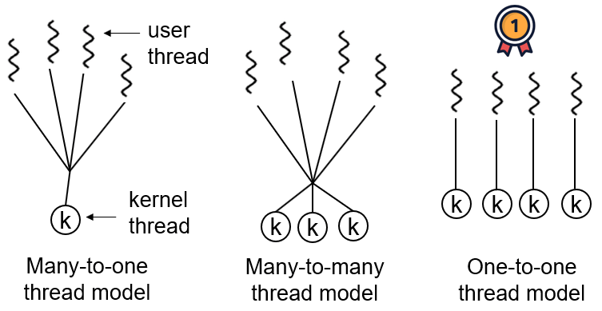
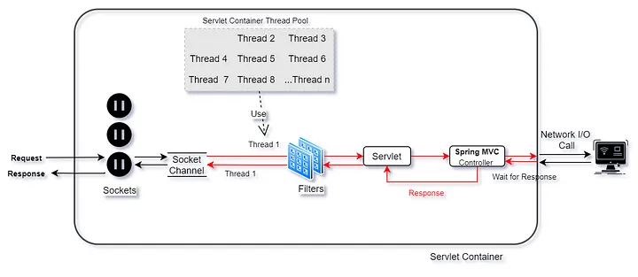
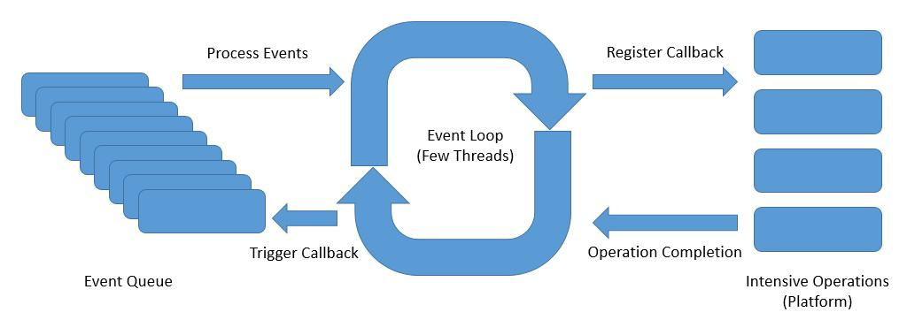
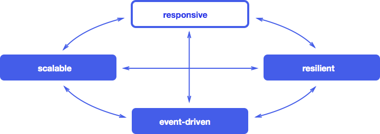

# Programmation Réactive en Java & SpringBoot

## Sommaire

## 1. Introduction

Depuis plusieurs années, le développement web en Java repose sur les servlets, un modèle synchrone et bloquant (modèle thread/request). Cependant, ce modèle devient rapidement inefficace dans les applications modernes et les
architectures microservices. Ces dernières nécessitent le traitement d'un grand nombre de requêtes simultanées en temps réel.  
Pour pallier ces contraintes, le modèle réactif a vu le jour, qui se base sur l'asynchronicité et le non-blocage, il permet une utilisation plus efficiente des ressources système.  
Ce POC vise à comparer le modèle traditionnel et l'approche réactive. Il propose une démo basée
sur [Project Reactor](https://projectreactor.io) et [Spring WebFlux](https://docs.spring.io/spring-framework/reference/web/webflux.html), en exposant les bases de programmation réactive et la manière d'intégrer ces outils avec des bases de données réactives.

## 2. Threads & Processus

Avant d'entamer la programmation réactive, nous allons voir comment un système d'exploitation gère les threads d'exécution.

### 2.1 Processus

Un processus correspond à l'exécution d'un programme exécutable. Il se compose de :
<figure>
  
  <figcaption style="text-align: center;"><strong>Processus</strong> - source: <a href="https://www.scaler.com/topics/linux-thread/">linux-thread</a></figcaption>
</figure>

- **Code (Text)**: contient les instructions du programme à exécuter (en mode read-only).
- **Data**: contient les variables globales et statiques initialisées.
- **Heap**: zone mémoire partagée entre les threads pour stocker les objets dynamiques.
- **Files**: descripteurs de fichiers ouverts par le processus (fichiers, sockets réseau, …).
- **Threads**: unités d'exécution concurrentes au sein du processus, partageant le même espace d'adressage.

### 2.2 Threads

Chaque Processus est constitué d'au moins un thread d'exécution, un thread représente une sous-tâche

Chaque thread possède :
- **Program Counter (PC)**: pointeur vers la prochaine instruction à exécuter.
- **Registers**: registres du processeur contenant les données en cours de traitement.
- **Stack**: zone mémoire privée contenant les variables locales et les paramètres des fonctions.

il existe deux types de threads:

<figure>
  
  <figcaption style="text-align: center;"><strong>User-Level thread vs Kernel-Level thread</strong> - source: <a href="https://www.scaler.com/topics/user-level-threads-and-kernel-level-threads/">ult-and-klt</a></figcaption>
</figure>

- **User-level threads (ULT)**: ce sont des threads créés et gérés par des programmes ou des bibliothèques, par exemple: les threads Java, les threads créés par le module threading de Python, POSIX threads (pthreads) en C/C++.
- **Kernel-level threads (KLT)**:  ce sont des threads créés et gérés au niveau du noyau du système d'exploitation. Ce sont les tâches qui sont planifiées pour l'exécution sur le CPU.

#### 2.2.1 Modèles du threading

les **User-level threads (ULT)** ne sont pas exécutés directement au niveau du processeur, mais ils sont liés à des **kernel-level threads (KLT)** exécutables.
Il existe plusieurs modèles de threading pour la correspondance entre ULT et KLT:

<figure>
  
  <figcaption style="text-align: center;"><strong>Types des Modèles du threading</strong> - source: <a href="https://www.researchgate.net/figure/Three-types-of-thread-models-Popular-operating-systems-5-22-24-adopt-the_fig1_346379550">Types of thread models</a></figcaption>
</figure>

- **Modèle 1:1**: Chaque **thread utilisateur ULT** est associé à **un thread noyau dédié KLT**.
- **Modèle M:N**: **M threads utilisateur ULT** sont associés à **N threads noyau KLT**.
- **Modèle M:1**: **Tous les threads utilisateur d'un processus ULT** partagent **un seul thread noyau KLT**.

**Java** utilise le modèle 1:1, où chaque thread Java (ULT) est lié à un KLT. En général les KLT coûteux à créer et à planifier au niveau du CPU. Par exemple, si un thread Java effectue un appel à une base de données (opération I/O (entrée/sortie)), son KLT associé reste bloqué en attendant la réponse. Pendant cette période, le thread Java reste inactif, ce qui n'est pas optimal en termes d'utilisation des ressources.
C'est ce problème que **la programmation réactive** cherche à résoudre, en proposant un modèle non-bloquant pour gérer efficacement les opérations I/O.

## 3. Modèle traditionnel vs Modèle réactif

### 3.1 Architecture et limites du modèle traditionnel (servlet)

Une application qui applique **le modèle traditionnel des servlets**, telle qu'une application web en Spring MVC déployée sur un conteneur de servlet comme Tomcat, fonctionne de la manière suivante:

Pour chaque requête utilisateur, le serveur :

- Crée un nouveau thread (ou plutôt récupère un thread à partir du threadpool de Tomcat, configuré avec `server.tomcat.threads.max=250` pour embedded Tomcat).
- Assigne ce thread au traitement complet de la requête.
- Attend la fin du traitement avant de rendre le thread disponible.

Le problème survient lorsque le traitement de la requête nécessite des opérations d'entrée/sortie (I/O) comme : la lecture/écriture d'un fichier, l'appel d'un service externe (API, BDD, microservice en GRPC, …). Dans ces situations, le thread reste bloqué sans rien faire en attendant la réponse de l'opération I/O. Cela entraîne une diminution du nombre de threads disponibles dans le threadpool pour traiter les autres requêtes utilisateur, limitant ainsi la capacité de l'application à gérer un nombre élevé de connexions simultanées.

En général, ce modèle ne convient que pour les applications intensives en calcul (**CPU-intensive**) qui utilisent le thread pour effectuer des calculs tout au long du traitement de la requête, telles qu'une web app qui fait des calculs mathématiques complexes ou un système de calcul financier.

<figure>
  
  <figcaption style="text-align: center;"><strong>Spring MVC (modèle servlet)</strong> - source: <a href="https://singhkaushal.medium.com/spring-webflux-eventloop-vs-thread-per-request-model-a42d07ee8502">Webflux vs Thread per request model</a></figcaption>
</figure>

### 3.2 Principes du modèle réactif
Le modèle réactif se base sur la boucle des événements (**Event Loop**), Contrairement au modèle traditionnel, au lieu de créer un thread par requête qui reste bloqué en attendant les opérations I/O, le modèle réactif crée un threadpool avec un nombre fixe de threads appelés **"Event Loop Threads"**. Ces threads traitent uniquement les requêtes à partir d'une file d'événements (**event queue**). Dès qu'une opération bloquante est rencontrée, le thread n'attend pas son résultat. A la place, il enregistre un callback qui s'exécutera ultérieurement quand la réponse sera prête. Entre-temps, le thread est libéré pour traiter d'autres requêtes.

C'est le modèle utilisé par exemple dans NodeJS, Netty (le serveur embarqué par défaut dans 
Spring Webflux).

<figure>
  
  <figcaption style="text-align: center;"><strong>Modèle Event Loop</strong> - source: <a href="https://www.baeldung.com/spring-webflux-concurrency">Concurrency in Spring WebFlux</a></figcaption>
</figure>

**Remarque**: La plupart des frameworks et langages qui se reposent sur ce modèle utilisent, afin de ne pas bloquer les event loop threads, des threads supplémentaires appelés worker threads. Ces derniers sont utilisés pour effectuer des calculs intensifs ou exécuter du code issu de bibliothèques proposant des API bloquantes (comme un ancien pilote de base de données). 

## 4. Fondamentaux de la programmation réactive

### 4.1 Reactive Manifesto
(Le manifeste Réactif)[ https://www.reactivemanifesto.org/fr ]  définit un système réactif comme étant un système distribué possédant quatre caractéristiques :
<figure>
  
  <figcaption style="text-align: center;"><strong>Caractéristiques d'un système réactif</strong> - source: <a href="https://www.reactivemanifesto.org/fr">Reactive Manifesto</a></figcaption>
</figure>

1. **Responsive**: il répond rapidement en toutes circonstances, si cela est possible.
2. **Elastic**: il reste disponible quelle que soit la charge de travail.
3. **Resilient**: il reste disponible en cas d'erreur.
4. **Message driven**: utilise le passage de messages
   asynchrones entre ses composants afin de garantir leur couplage
   faible, leur isolation, la transparence de localisation ainsi que la
   délégation d’erreurs à d’autres composants

### 4.2 L'initiative Reactive Streams vs. JDK9

(Reactive Streams)[ https://www.reactive-streams.org/ ] est une spécification pour le traitement asynchrone des flux de données, principalement destinée à l'écosystème Java. Elle a été adoptée par plusieurs bibliothèques de programmation réactive telles que RxJava 2 et Reactor. Avec l’arrivée de Java 9, les interfaces de cette spécification (`Publisher`, `Subscriber`, `Subscription`, `Processor`) ont été intégrées directement dans le JDK via le package `java.util.concurrent.Flow`, tout en conservant la même sémantique.

Toutefois, la majorité des bibliothèques ont décidé de rester sur `Reactive Streams` pour garantir une compatibilité avec Java 8.

[//]: # (Dans cette section, nous allons donc utiliser les interfaces de `java.util.concurrent.Flow`, étant donné leur similarité puisqu'elles sont similaires à celles de `Reactive Streams`.)

### 4.3 Concepts clés (Back pressure, Event-loop, Non-blocking I/O)

## 5. Implémentations Java de la programmation réactive

### 5.1 Panorama (Reactor, RxJava, Mutiny, Vert.x)

### 5.2 Project Reactor en détail

#### 5.2.1 Reactor Core (Flux et Mono)

#### 5.2.2 Opérateurs essentiels

#### 5.2.3 Reactor Netty

#### 5.2.4 Reactor Kafka

## 6. Spring WebFlux

### 6.1 Architecture et principes

### 6.2 API fonctionnelle vs Annotations

## 7. Persistance réactive avec R2DBC

### 7.1 Principes de R2DBC

### 7.2 Intégration avec Spring Data

## 8. POC pratique

### 8.1 Architecture de l'application

### 8.2 API réactive avec Spring WebFlux

### 8.3 Persistance avec R2DBC PostgreSQL

### 8.4 Intégration Kafka

### 8.5 Interface utilisateur avec HTMX

## 9. Spring WebFlux vs Spring MVC

### 9.1 Comparaison des performances

### 9.2 Cas d'usage appropriés

## 10. Bonus: Implémentation sous le capot

### 10.1 Les syscalls epoll/kqueue et la programmation événementielle

### 10.2 Modèles de concurrence: Thread pools vs Event loops

## 11. Project Loom & virtual threads
## 12. Références