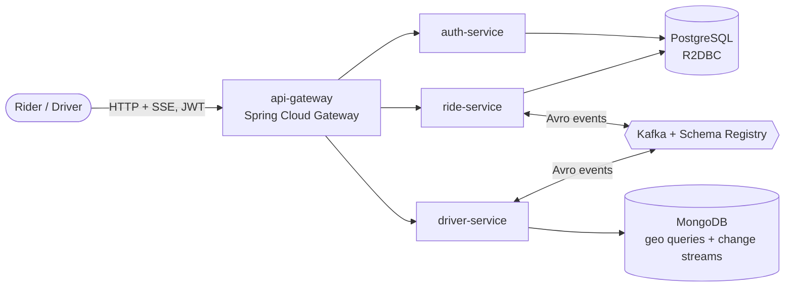
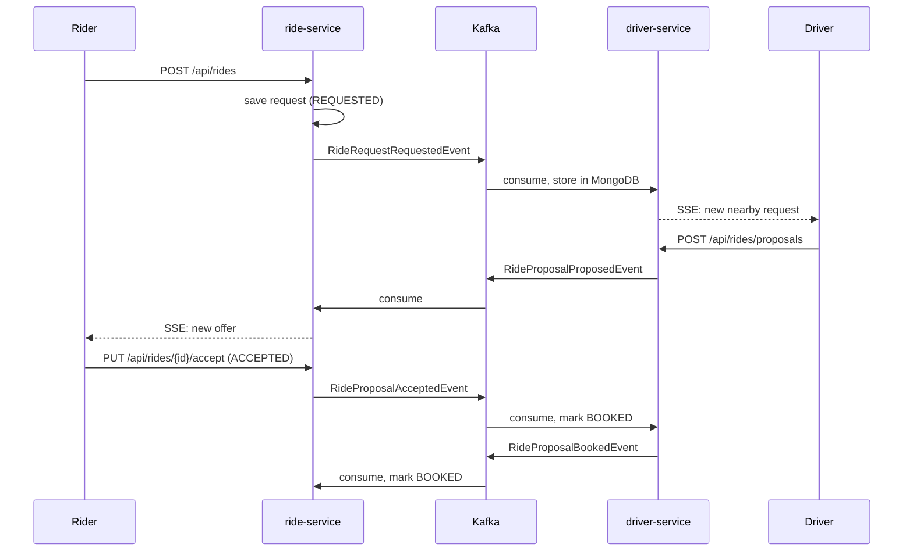
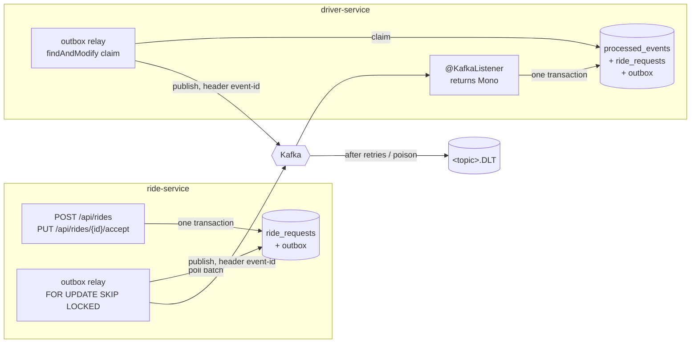

# Reactive Ride-Hailing

[](https://github.com/HIMMIREDA/reactive-ride-hailing/actions/workflows/ci.yml)

*English · [Français](README.fr.md)*

A ride-hailing backend built reactive end to end with Spring WebFlux, Kafka, R2DBC and MongoDB. A rider posts a ride request, nearby drivers see it in real time and send price offers, and the rider sees the offers live and accepts one.

I built it to compare the thread-per-request model with the reactive model. The full write-up on reactive programming in Java (threads, Reactive Streams, Reactor, WebFlux internals, R2DBC, Kafka) is in [GUIDE.md](GUIDE.md) ([French version](GUIDE.fr.md)).

## Architecture



| Service | Role | Storage |
| --- | --- | --- |
| api-gateway | Single entry point (port 8085), routing and authorization | – |
| auth-service | Sign-up and login, issues JWTs | PostgreSQL (R2DBC) |
| ride-service | Rider side: create requests, stream offers, accept one | PostgreSQL (R2DBC) |
| driver-service | Driver side: stream nearby requests, send offers | MongoDB (reactive) |
| common | Avro schemas and event classes shared by the services | – |

## Ride lifecycle



## Tech stack

- Java 21, Spring Boot 3.5, Spring WebFlux on Reactor Netty
- Spring Cloud Gateway (reactive), Spring Security, JWT
- PostgreSQL with Spring Data R2DBC
- MongoDB with Spring Data MongoDB Reactive: geospatial queries and change streams
- Apache Kafka (KRaft mode), Confluent Schema Registry, Avro
- Spring Kafka: `KafkaTemplate` and `@KafkaListener` methods returning `Mono`, with retries and dead-letter topics
- Server-Sent Events for real-time updates
- Docker Compose, AKHQ (Kafka web UI)

## Running it locally

Prerequisites: Docker with Compose v2 and Buildx (both included in Docker Desktop and in the docker-ce packages; on some Linux distributions Buildx is a separate package such as `docker-buildx`). Java 21 and Maven are only needed to run the tests or a service outside Docker.

```bash
cd spring-webflux-poc
cp .env.example .env
# set JWT_SECRET in .env (PostgreSQL credentials too, if you like):
#   JWT_SECRET=$(openssl rand -base64 64 | tr -d '\n')
docker compose up --build      # or: docker compose up -d --build --wait
```

Compose builds the four service images, starts PostgreSQL, MongoDB (replica set), Kafka, Schema Registry and AKHQ, registers the Avro schemas (one-shot `schema-init` container), and starts each service only once what it depends on is healthy. The first build downloads the Maven dependencies; later builds reuse a BuildKit cache.

Once everything is healthy, run the end-to-end smoke test from the repository root (needs `curl` and `jq`). It signs up a rider and a driver, creates a ride, sends and accepts an offer, and checks that the ride ends `BOOKED`:

```bash
scripts/smoke-test.sh            # from the repository root
../scripts/smoke-test.sh         # or from spring-webflux-poc/
```

Published ports: API gateway http://localhost:8085 and AKHQ http://localhost:9000. Nothing else is reachable from the host (see [Design choices](#design-choices)). To reach a database, Kafka, Schema Registry or a service directly while debugging, copy `spring-webflux-poc/docker-compose.override.example.yml` to `docker-compose.override.yml` (gitignored); the file explains what it opens.

### Run a service from your IDE

1. `cp docker-compose.override.example.yml docker-compose.override.yml`, then `docker compose up -d` (publishes the infrastructure ports the services use by default).
2. `docker compose stop ride-service` (the service you want to work on).
3. Run it from your IDE or with `mvn spring-boot:run` in its module, without the `docker` profile: it uses `localhost` and reads `spring-webflux-poc/.env`.

The gateway container still routes to the `ride-service` container name. To send traffic through a gateway to your IDE instance, run `api-gateway` from the IDE as well (its defaults point at `localhost:8082`-`8084`).

A Postman collection is included: `spring-webflux-poc/poc-spring-webflux.postman_collection.json`. Run it top to bottom: the login requests store the JWTs in the collection variables `{{jwt}}` (rider) and `{{driverJwt}}` (driver), and the create/propose requests store the ids the next requests need. No token is stored in the file.

## API

All requests go through the gateway on port 8085. Every endpoint except sign-up and login needs an `Authorization: Bearer <JWT>` header.

| Method | Path | Role | What it does |
| --- | --- | --- | --- |
| POST | `/api/users` | – | Sign up as USER or DRIVER |
| POST | `/api/users/auth` | – | Log in, returns a JWT |
| POST | `/api/rides` | USER | Create a ride request |
| GET | `/api/rides/{rideRequestId}/proposals/stream` | USER | Live stream (SSE) of driver offers |
| PUT | `/api/rides/{rideRequestId}/accept` | USER | Accept an offer |
| GET | `/api/rides/nearby/stream?lat=…&lng=…&radius=…` | DRIVER | Live stream (SSE) of nearby requests, radius in km |
| POST | `/api/rides/proposals` | DRIVER | Send a price offer |

Example: create a ride request.

```bash
curl -X POST http://localhost:8085/api/rides -H "Content-Type: application/json" -H "Authorization: Bearer YOUR_JWT_TOKEN" -d '{"startLng": 20.2, "startLat": 33.2, "endLng": 20.1, "endLat": 50.1, "seats": 2, "preferredPrice": 12.22}'
```

More curl examples are in [GUIDE.md, section 8.5](GUIDE.md#85-api-endpoints).

## Design choices

- **Reactive end to end.** One blocking call on a Netty event loop stalls every connection that loop serves, so every I/O goes through a non-blocking driver: R2DBC for PostgreSQL, the reactive MongoDB driver, and Kafka through `KafkaTemplate` and `@KafkaListener` wrapped in `Mono` (the one potentially blocking call, `send()` waiting for metadata, runs on `boundedElastic`).
- **Nearby requests = history + live feed.** driver-service first returns matching requests with a geospatial query, then follows new ones through a MongoDB change stream, and joins the two with `Flux.concat`. The service opens **one** change stream at startup and shares it with every SSE connection (`Sinks.many().multicast().directBestEffort()`); each connection filters it by distance and has its own bounded buffer, so a slow client never holds up the others. After an error the stream reopens with its resume token. Change streams need a replica set, which is why Docker Compose starts MongoDB as a single-node replica set.
- **Typed events.** Kafka events are Avro records registered in Schema Registry, generated in the `common` module and shared by all services.
- **Each service owns its data.** ride-service keeps the rider's view in PostgreSQL; driver-service keeps its own copy in MongoDB, where geo queries and change streams are built in.
- **The gateway is the only entry point.** api-gateway verifies the JWT, removes any identity headers sent by the client (`X-User-Id`, `X-Role`, `X-Email`, `X-First-Name`, `X-Last-Name`, `X-Phone-Number`) and sets them from the token's claims. auth-, ride- and driver-service trust these headers without checking anything, so they must never be reachable directly: anyone who can call them without going through the gateway can pick any identity. Keep them on a private network and expose only the gateway: `docker compose` does exactly that, only the gateway (and AKHQ) publish ports.

## Reliability



- **No dual write.** A service never sends to Kafka in the request path. It writes the event to an `outbox` table (PostgreSQL) or collection (MongoDB) in the **same transaction** as the business change, so the change and its event are committed together or not at all. The API keeps working while Kafka is down; the events wait in the outbox.
- **Outbox relay.** A background loop in each service publishes the outbox in order, puts the event id in an `event-id` header and marks the row published only after Kafka acknowledged it. On failure it stops the batch and backs off exponentially. Several instances can run side by side: PostgreSQL rows are locked with `SELECT ... FOR UPDATE SKIP LOCKED` (an instance skips rows another one holds), MongoDB documents are claimed with an atomic `findAndModify` and a lease.
- **At-least-once.** If a relay dies after Kafka's ack but before marking the row, the event is published again. Kafka consumer retries and redeliveries also produce duplicates. So every consumer is idempotent.
- **Idempotent consumers.** Each listener records `(event id, consumer)` in a `processed_events` table/collection in the same transaction as the state change, and skips an event it has already processed. I chose this over relying only on guarded state transitions (`ACCEPTED -> BOOKED`) because it is explicit, covers events that are not transitions (storing a new request), and stays correct when two deliveries of the same event are processed concurrently (async listeners do that). The status guards remain as a second line of defence.
- **Ordering.** Within one relay, events are published in commit order. With several relays, or with retries, a later event can overtake an earlier one; consumers tolerate it (an event about an unknown request is retried, then dead-lettered).
- **Why polling and not CDC.** The alternative is change data capture: Debezium reads the PostgreSQL WAL / MongoDB oplog and publishes outbox rows through Kafka Connect, with lower latency and no polling queries. It also needs Kafka Connect, Debezium connectors, logical replication settings and their monitoring. For this project a polling relay is a few dozen lines, runs inside the service, works the same in Docker Compose, CI and Testcontainers, and its sub-second latency is fine. At higher volume, Debezium's outbox event router would be the next step.

## TODO

- [x] **Make database and Kafka writes atomic.** Transactional outbox in ride-service (PostgreSQL) and driver-service (MongoDB transaction), published by a polling relay; consumers are idempotent. See [Reliability](#reliability).
- [x] **Acknowledge offsets after the follow-up event is sent.** Listeners return a `Mono` and the offset is committed only when it completes, i.e. after the booked event is acknowledged by Kafka. An event about an unknown request or offer is logged, retried and sent to its dead-letter topic instead of being skipped.
- [x] **Add error recovery to the Kafka consumers.** Failures are retried with exponential backoff, then the record goes to `<topic>.DLT`; records that can't be deserialized go straight to the DLT. One bad record no longer stops consumption.
- [x] **Share one change stream across drivers.** One change stream per service instance, opened at startup and multicast to every SSE connection (bounded buffer per connection, resume token after errors), instead of one per connection.
- [x] **Migrate off Reactor Kafka.** Reactor Kafka was discontinued in May 2025 and Spring Kafka's reactive templates are deprecated ([announcement](https://spring.io/blog/2025/05/20/reactor-kafka-discontinued)). The services now use plain Spring Kafka: `KafkaTemplate` bridged with `Mono.fromFuture`, and `@KafkaListener` methods returning `Mono<Void>`.
- [x] **Add automated tests.** Integration tests with Testcontainers (Kafka, PostgreSQL, MongoDB) and `StepVerifier` for the reactive pipelines.
- [x] **Return 409 for invalid status transitions.** Accepting a ride request that is no longer `REQUESTED` returns 409 Conflict instead of 404 Not Found.
- [x] **Test the gateway's authentication.** Missing, malformed, wrongly signed and expired tokens get 401; valid tokens are forwarded with identity headers, and identity headers sent by clients are dropped.
- [x] **Move the JWT secret out of the code.** auth-service and api-gateway read it from the `JWT_SECRET` environment variable (or `.env`) and refuse to start if it is missing or shorter than 64 bytes.
