# Programmation Réactive en Java & SpringBoot

## Sommaire

## 1. Introduction

Depuis plusieurs années, le développement web en Java repose sur les servlets, un modèle synchrone et bloquant (modèle thread/request). Cependant, ce modèle devient rapidement inefficace dans les applications modernes et les
architectures microservices. Ces dernières nécessitent le traitement d'un grand nombre de requêtes simultanées en temps réel.  
Pour pallier ces contraintes, le modèle réactif a vu le jour, qui se base sur l'asynchronicité et le non-blocage, il permet une utilisation plus efficiente des ressources système.  
Ce POC vise à comparer le modèle traditionnel et l'approche réactive. Il propose une démo basée
sur [Project Reactor](https://projectreactor.io) et [Spring WebFlux](https://docs.spring.io/spring-framework/reference/web/webflux.html), en exposant les bases de programmation réactive et la manière d'intégrer ces outils avec des bases de données réactives.

## 2. Threads & Processus

Avant d'entamer la programmation réactive, nous allons voir comment un système d'exploitation gère les threads d'exécution.

### 2.1 Processus

Un processus correspond à l'exécution d'un programme exécutable. Il se compose de :
<figure>
  
  <figcaption style="text-align: center;"><strong>Processus</strong> - source: <a href="https://www.scaler.com/topics/linux-thread/">linux-thread</a></figcaption>
</figure>

- **Code (Text)**: contient les instructions du programme à exécuter (en mode read-only).
- **Data**: contient les variables globales et statiques initialisées.
- **Heap**: zone mémoire partagée entre les threads pour stocker les objets dynamiques.
- **Files**: descripteurs de fichiers ouverts par le processus (fichiers, sockets réseau, …).
- **Threads**: unités d'exécution concurrentes au sein du processus, partageant le même espace d'adressage.

### 2.2 Threads

Chaque Processus est constitué d'au moins un thread d'exécution, un thread représente une sous-tâche

Chaque thread possède :
- **Program Counter (PC)**: pointeur vers la prochaine instruction à exécuter.
- **Registers**: registres du processeur contenant les données en cours de traitement.
- **Stack**: zone mémoire privée contenant les variables locales et les paramètres des fonctions.

il existe deux types de threads:

<figure>
  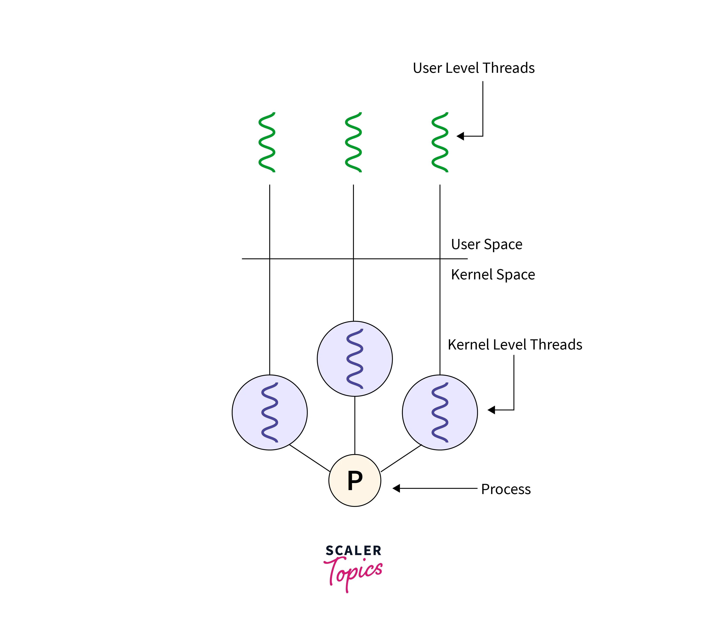
  <figcaption style="text-align: center;"><strong>User-Level thread vs Kernel-Level thread</strong> - source: <a href="https://www.scaler.com/topics/user-level-threads-and-kernel-level-threads/">ult-and-klt</a></figcaption>
</figure>

- **User-level threads (ULT)**: ce sont des threads créés et gérés par des programmes ou des bibliothèques, par exemple: les threads Java, les threads créés par le module threading de Python, POSIX threads (pthreads) en C/C++.
- **Kernel-level threads (KLT)**:  ce sont des threads créés et gérés au niveau du noyau du système d'exploitation. Ce sont les tâches qui sont planifiées pour l'exécution sur le CPU.

#### 2.2.1 Modèles du threading

les **User-level threads (ULT)** ne sont pas exécutés directement au niveau du processeur, mais ils sont liés à des **kernel-level threads (KLT)** exécutables.
Il existe plusieurs modèles de threading pour la correspondance entre ULT et KLT:

<figure>
  
  <figcaption style="text-align: center;"><strong>Types des Modèles du threading</strong> - source: <a href="https://www.researchgate.net/figure/Three-types-of-thread-models-Popular-operating-systems-5-22-24-adopt-the_fig1_346379550">Types of thread models</a></figcaption>
</figure>

- **Modèle 1:1**: Chaque **thread utilisateur ULT** est associé à **un thread noyau dédié KLT**.
- **Modèle M:N**: **M threads utilisateur ULT** sont associés à **N threads noyau KLT**.
- **Modèle M:1**: **Tous les threads utilisateur d'un processus ULT** partagent **un seul thread noyau KLT**.

**Java** utilise le modèle 1:1, où chaque thread Java (ULT) est lié à un KLT. En général les KLT sont coûteux à créer et à planifier au niveau du CPU. Par exemple, si un thread Java effectue un appel à une base de données (opération I/O (entrée/sortie)), son KLT associé reste bloqué en attendant la réponse. Pendant cette période, le thread Java reste inactif, ce qui n'est pas optimal en termes d'utilisation des ressources.
C'est ce problème que **la programmation réactive** cherche à résoudre, en proposant un modèle non-bloquant pour gérer efficacement les opérations I/O.

## 3. Modèle traditionnel vs Modèle réactif

### 3.1 Architecture et limites du modèle traditionnel (servlet)

Une application qui applique **le modèle traditionnel des servlets**, telle qu'une application web en Spring MVC déployée sur un conteneur de servlet comme Tomcat, fonctionne de la manière suivante:

Pour chaque requête utilisateur, le serveur :

- Crée un nouveau thread (ou plutôt récupère un thread à partir du threadpool de Tomcat, configuré avec `server.tomcat.threads.max=250` pour embedded Tomcat).
- Assigne ce thread au traitement complet de la requête.
- Attend la fin du traitement avant de rendre le thread disponible.

Le problème survient lorsque le traitement de la requête nécessite des opérations d'entrée/sortie (I/O) comme : la lecture/écriture d'un fichier, l'appel d'un service externe (API, BDD, microservice en GRPC, …). Dans ces situations, le thread reste bloqué sans rien faire en attendant la réponse de l'opération I/O. Cela entraîne une diminution du nombre de threads disponibles dans le threadpool pour traiter les autres requêtes utilisateur, limitant ainsi la capacité de l'application à gérer un nombre élevé de connexions simultanées.

En général, ce modèle ne convient que pour les applications intensives en calcul (**CPU-intensive**) qui utilisent le thread pour effectuer des calculs tout au long du traitement de la requête, telles qu'une web app qui fait des calculs mathématiques complexes ou un système de calcul financier.

<figure>
  
  <figcaption style="text-align: center;"><strong>Spring MVC (modèle servlet)</strong> - source: <a href="https://singhkaushal.medium.com/spring-webflux-eventloop-vs-thread-per-request-model-a42d07ee8502">Webflux vs Thread per request model</a></figcaption>
</figure>

### 3.2 Principes du modèle réactif
Le modèle réactif se base sur la boucle des événements (**Event Loop**), Contrairement au modèle traditionnel, au lieu de créer un thread par requête qui reste bloqué en attendant les opérations I/O, le modèle réactif crée un threadpool avec un nombre fixe de threads appelés **"Event Loop Threads"**. Ces threads traitent uniquement les requêtes à partir d'une file d'événements (**event queue**). Dès qu'une opération bloquante est rencontrée, le thread n'attend pas son résultat. A la place, il enregistre un callback qui s'exécutera ultérieurement quand la réponse sera prête. Entre-temps, le thread est libéré pour traiter d'autres requêtes.

C'est le modèle utilisé par exemple dans NodeJS, Netty (le serveur embarqué par défaut dans 
Spring Webflux).

<figure>
  
  <figcaption style="text-align: center;"><strong>Modèle Event Loop</strong> - source: <a href="https://www.baeldung.com/spring-webflux-concurrency">Concurrency in Spring WebFlux</a></figcaption>
</figure>

**Remarque**: La plupart des frameworks et langages qui se reposent sur ce modèle utilisent, afin de ne pas bloquer les event loop threads, des threads supplémentaires appelés worker threads. Ces derniers sont utilisés pour effectuer des calculs intensifs ou exécuter du code issu de bibliothèques proposant des API bloquantes (comme un ancien pilote de base de données). 

## 4. Fondamentaux de la programmation réactive

### 4.1 Reactive Manifesto
(Le manifeste Réactif)[ https://www.reactivemanifesto.org/fr ]  définit un système réactif comme étant un système distribué possédant quatre caractéristiques :
<figure>
  
  <figcaption style="text-align: center;"><strong>Caractéristiques d'un système réactif</strong> - source: <a href="https://www.reactivemanifesto.org/fr">Reactive Manifesto</a></figcaption>
</figure>

1. **Responsive**: il répond rapidement en toutes circonstances, si cela est possible.
2. **Elastic**: il reste disponible quelle que soit la charge de travail.
3. **Resilient**: il reste disponible en cas d'erreur.
4. **Message driven**: utilise le passage de messages
   asynchrones entre ses composants afin de garantir leur couplage
   faible, leur isolation, la transparence de localisation ainsi que la
   délégation d’erreurs à d’autres composants

### 4.2 L'initiative Reactive Streams vs. JDK9

[Reactive Streams](https://www.reactive-streams.org/) est une spécification pour le traitement asynchrone des flux de données, principalement destinée à l'écosystème Java. Elle a été adoptée par plusieurs bibliothèques de programmation réactive telles que RxJava 2 et Reactor. Avec l’arrivée de Java 9, les interfaces de cette spécification (`Publisher`, `Subscriber`, `Subscription`, `Processor`) ont été intégrées directement dans le JDK via le package `java.util.concurrent.Flow`, tout en conservant la même sémantique.

**Toutefois, la majorité des bibliothèques ont décidé de rester sur `Reactive Streams` pour garantir une compatibilité avec Java 8.**

**Interfaces de base de Reactive Streams :**

* **`Publisher<T>` :** représente une source de flux de données asynchrones. Son rôle est de produire des éléments et de les envoyer à un ou plusieurs `Subscriber`. Elle ne possède qu'une seule méthode :
   ```java
   public interface Publisher<T> {     
       public void subscribe(Subscriber<? super T> s);
   }
   ```
Cette méthode est appelée par un `Subscriber` pour commencer à recevoir les éléments.

* **`Subscriber<T>` :** représente un consommateur de données émises par un `Publisher`. Il définit les méthodes de callback pour réagir aux événements du flux :
   ```java
   public interface Subscriber<T> {     
       public void onSubscribe(Subscription s);
       public void onNext(T item);
       public void onError(Throwable t);
       public void onComplete();
   }
   ```
   * `onSubscribe(Subscription s)` : appelée lors de la souscription, fournissant un objet de type `Subscription` pour contrôler le flux.
   * `onNext(T item)` : appelée pour chaque élément émis par le `Publisher`.
   * `onError(Throwable t)` : appelée si le `Publisher` termine avec une erreur.
   * `onComplete()` : appelée si le `Publisher` termine avec succès.

* **`Subscription` :** représente la relation entre un `Subscriber` et un `Publisher`. C'est un contrat qui permet au `Subscriber` de contrôler le flux de données qu'il reçoit. Elle définit deux méthodes principales pour la gestion du back pressure :
   ```java
   public interface Subscription {
     public void request(long n);
     public void cancel();
   }
   ```
   * `request(long n)` : permet au `Subscriber` de demander au `Publisher` d'émettre au plus `n` éléments supplémentaires. C'est le mécanisme clé pour implémenter le back pressure.
   * `cancel()` : Permet au `Subscriber` d'annuler sa souscription, signifiant qu'il ne souhaite plus recevoir d'éléments.

* **`Processor<T, R>` :** représente un composant qui est à la fois un `Subscriber<T>` et un `Publisher<R>`. Il peut recevoir des éléments, les traiter, et ensuite publier le résultat. C'est utile pour les étapes intermédiaires dans une chaîne de traitement. L'interface `Processor` étend les deux interfaces :
    ```java
    public interface Processor<T, R> extends Subscriber<T>, Publisher<R> {
    }
    ```
  
### 4.3 Concepts clés (Back pressure, Event-loop, Non-blocking I/O)
#### 4.3.1 Back pressure
<figure>
  
  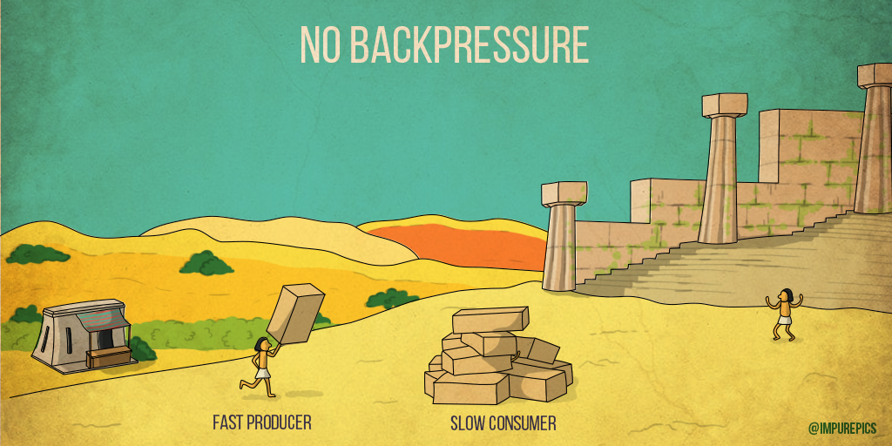
  <figcaption style="text-align: center;"><strong>Origines de Back pressure</strong> - source: <a href="https://impurepics.com/posts/2018-05-26-backpressure-origins.html" target="_blank" rel="noopener noreferrer">Back Pressure</a></figcaption>
</figure>

Le **back pressure** est un mécanisme crucial dans la programmation réactive qui permet au consommateur de données de signaler au producteur qu'il est submergé et qu'il ne peut pas traiter les données au rythme où elles sont émises. Sans back pressure, un consommateur lent pourrait être dépassé par un producteur rapide, entraînant des problèmes comme une utilisation excessive de la mémoire ou la perte de données.

#### 4.3.2 Event-loop
L'**Event-loop** est un modèle de programmation asynchrone non bloquant où un seul thread exécute une boucle pour traiter les événements. Au lieu d'attendre la fin des opérations d'E/S, le thread principal lance l'opération et continue. Lorsqu'un résultat est disponible, un événement est déclenché, et le thread principal exécute le gestionnaire (callback) associé. Ceci permet une haute réactivité en évitant le blocage du thread principal.

#### 4.3.3 Non-blocking IO
Les **opérations d'E/S non bloquantes** (**Non-Blocking IO**) permettent à un thread d'initier une opération d'entrée ou de sortie sans attendre sa complétion. Le thread peut ensuite poursuivre d'autres tâches. Une notification est reçue lorsque l'opération est terminée. Contrairement aux E/S bloquantes, cela permet à un nombre limité de threads de gérer de nombreuses opérations concurrentes, améliorant ainsi la performance et la réactivité des applications.


## 5. Implémentations Java de la programmation réactive
Plusieurs librairies Java facilitent l'adoption du paradigme de la programmation réactive. Parmi les plus notables, on trouve :

* **[Project Reactor](https://projectreactor.io/) :** Développé par Pivotal (maintenant VMware), Reactor est une implémentation de la spécification **Reactive Streams**. Il fournit les types fondamentaux **Flux** (pour les séquences de 0 à N éléments) et **Mono** (pour les séquences de 0 ou 1 élément), et met l'accent sur le back pressure et un riche ensemble d'opérateurs pour la manipulation asynchrone de flux de données non bloquants. Reactor est notamment la base réactive de Spring WebFlux. C'est notre sujet de POC avec **Spring WebFlux**.

* **[RxJava](https://github.com/ReactiveX/RxJava) :** Librairie mature suivant le modèle **[ReactiveX](https://reactivex.io/)**, RxJava introduit les **Observable** pour représenter des flux de données asynchrones.

* **[Mutiny](https://smallrye.io/smallrye-mutiny/2.4.0/) :** Développé par Red Hat, Mutiny offre une API réactive plus impérative pour Java et Kotlin, avec les types **Multi** et **Uni** pour les flux et les résultats uniques.

### 5.1 Project Reactor en détail
#### 5.1.1 Reactor Core (Flux vs Mono vs Publisher)
Au coeur de **Project Reactor** et de la spécification **Reactive Streams** se trouve l'interface `Publisher<T>` [Voir la section Reactive Streams vs jdk9](#42-linitiative-reactive-streams-vs-jdk9).
Comme mentionné précédemment, `Publisher<T>` est l'interface fondamentale de Reactive Streams, représentant une source de données asynchrones. Project Reactor fournit deux implémentations principales de cette interface: `Flux` et `Mono`.

* **`Flux<T>` :** Est un `Publisher` qui peut émettre une séquence de **0 à n** éléments. Il est utilisé pour représenter un flux de données qui peut contenir plusieurs éléments, qu'ils arrivent de manière continue (**Stream of events**) ou à la fin d'une opération.

   ```java
    Flux<String> items = Flux.just("Reda", "Java", "Golang", "ILI");
    items.subscribe(item -> System.out.println("item: " + item));
  
   // Supposons que getStockData retourne un Flux<StockData>
   Flux<StockData> stockDataFlux = getStockData("GOOGLE");
   ```

* **`Mono<T>` :** Est également un `Publisher`mais spécialisé pour émettre **0 ou 1** élément. Il est utilisé pour représenter le résultat asynchrone d'une opération qui peut produire zéro ou un résultat, comme la récupération d'un seul enregistrement d'une table de base de données.

    ```java
    Mono<String> user = Mono.just("Reda Himmi");
    user.subscribe(u -> System.out.println("User: " + u));

    Mono<Void> op = Mono.empty().doOnTerminate(() -> System.out.println("Opération terminée."));
    operationTerminee.subscribe();
    ```

En résumé, `Publisher` est l'interface, `Flux` est l'implémentation pour les séquences de **0 à n** éléments, et `Mono` est l'implémentation pour les séquences de **0 ou 1** élément.

Remarque: **Il est aussi important de noter qu'un `Publisher` ne commence à émettre des éléments que lorsqu'un `Subscriber` s'y abonne via la méthode `subscribe()` ou `subscribe(Consumer<? super T> consumer)`**

#### 5.2.2 Opérateurs essentiels

1.  `just()`: Crée un `Flux` ou un `Mono` qui émet les éléments passés en paramètre, puis se complète. C'est un moyen simple de créer un Publisher statique.
<figure>

  <figcaption style="text-align: center;"><strong>just()</strong> - source: <a href="https://projectreactor.io/docs/core/release/api/reactor/core/publisher/Flux.html#just-T...-">Flux</a></figcaption>
</figure>

```java
    Flux.just("Hello", "ILI");
    Mono.just("Reda ILI");
```

2. `subscribe()`: Déclenche l'émission des éléments d'un Publisher en attachant un `Subscriber`. C'est l'opération qui active le flux. Elle correspond à l'appel de la méthode `subscribe(Subscriber s)` de l'interface Publisher.
<figure>
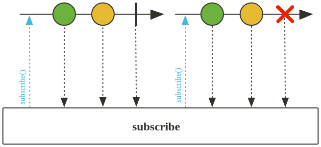
  <figcaption style="text-align: center;"><strong>Subscribe()</strong> - source: <a href="https://projectreactor.io/docs/core/release/api/reactor/core/publisher/Flux.html#subscribe--">Subscribe()</a></figcaption>
</figure>

```java
    Flux.just("a", "b").subscribe(System.out::println);
```

3. `doOnNext(Consumer<? super T> onNext)` : permet d'exécuter un callback pour chaque élément émis par le `Publisher`, sans modifier l'élément lui-même.
<figure>
  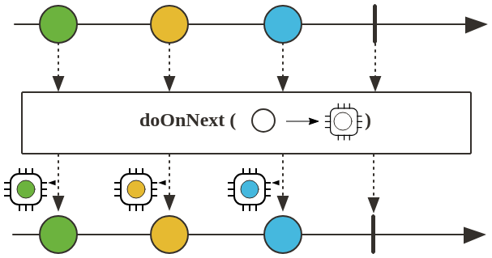
  <figcaption style="text-align: center;"><strong>doOnNext()</strong> - source: <a href="https://projectreactor.io/docs/core/release/api/reactor/core/publisher/Flux.html#doOnNext-java.util.function.Consumer-">doOnNext()</a></figcaption>
</figure>

```java
    Flux.just("Reda", "Himmi")
        .doOnNext(item -> System.out.println("Processing: " + item))
        .subscribe(System.out::println);
```
4. `map(Function<? super T, ? extends R> mapper)` : transforme chaque élément émis par le `Publisher` en appliquant une fonction synchrone.
<figure>
  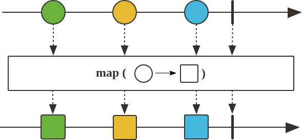
  <figcaption style="text-align: center;"><strong>map()</strong> - source: <a href="https://projectreactor.io/docs/core/release/api/reactor/core/publisher/Flux.html#map-java.util.function.Function-">map()</a></figcaption>
</figure>

```java
    Flux.just("ili", "reda")
        .map(String::toUpperCase)
        .subscribe(System.out::println);
```

5. `filter(Predicate<? super T> predicate)` : émet uniquement les éléments qui satisfont un prédicat donné.
<figure>
  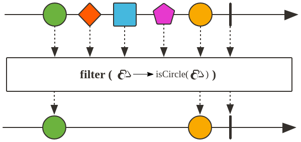
  <figcaption style="text-align: center;"><strong>filter()</strong> - source: <a href="https://projectreactor.io/docs/core/release/api/reactor/core/publisher/Flux.html#filter-java.util.function.Predicate-">filter()</a></figcaption>
</figure>

```java
    Flux.range(1, 5)
        .filter(n -> n % 2 == 0)
        .subscribe(System.out::println);
```

6. `flatMap(Function<? super T, ? extends Publisher<? extends V>> mapper)` : transforme chaque élément en un `Publisher` et fusionne les flux résultants. L'ordre des éléments émis peut ne pas être conservé.
<figure>
  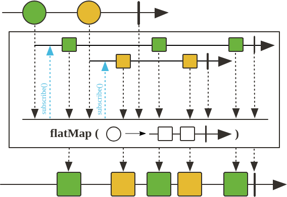
  <figcaption style="text-align: center;"><strong>flatMap()</strong> - source: <a href="https://projectreactor.io/docs/core/release/api/reactor/core/publisher/Flux.html#flatMap-java.util.function.Function-">flatMap()</a></figcaption>
</figure>

```java
Flux.just(1, 2)
    .flatMap(x -> Mono.just("value " + x))
    .subscribe(System.out::println);
```

7. `concatMap(Function<? super T, ? extends Publisher<? extends V>> mapper)` : Similaire à `flatMap`, mais garantit que les éléments des `Publisher`s internes sont émis dans l'ordre du flux source.
<figure>
  
  <figcaption style="text-align: center;"><strong>concatMap()</strong> - source: <a href="https://projectreactor.io/docs/core/release/api/reactor/core/publisher/Flux.html#concatMap-java.util.function.Function-">concatMap()</a></figcaption>
</figure>

```java
Flux.just(1, 2)
    .concatMap(x -> Mono.just("value " + x).delayElement(java.time.Duration.ofMillis(100 * x)))
    .subscribe(System.out::println);  // va afficher: "value: 1" puis "value: 2"
```

8. `delayElements(Duration period)` : introduit un délai entre l'émission de chaque élément.
<figure>
  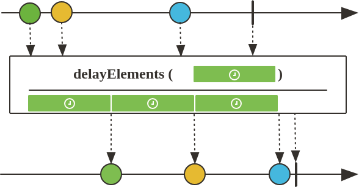
  <figcaption style="text-align: center;"><strong>delayElements()</strong> - source: <a href="https://projectreactor.io/docs/core/release/api/reactor/core/publisher/Flux.html#delayElements-java.time.Duration-">delayElements()</a></figcaption>
</figure>

```java
    Flux.just("one", "two").delayElements(java.time.Duration.ofSeconds(1)).subscribe(System.out::println);
```

9. `take(long n)` : émet seulement les n premiers éléments, puis se complète.
<figure>
  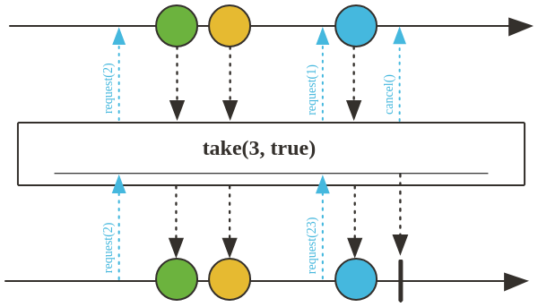
  <figcaption style="text-align: center;"><strong>take()</strong> - source: <a href="https://projectreactor.io/docs/core/release/api/reactor/core/publisher/Flux.html#take-long-">take()</a></figcaption>
</figure>

```java
    Flux.range(1, 10).take(3).subscribe(System.out::println);
```

10. `interval(Duration period)` : crée un Flux qui émet des Longs à intervalles réguliers.
<figure>
  
  <figcaption style="text-align: center;"><strong>interval()</strong> - source: <a href="https://projectreactor.io/docs/core/release/api/reactor/core/publisher/Flux.html#interval-java.time.Duration-">interval()</a></figcaption>
</figure>

```java
    Flux.interval(java.time.Duration.ofMillis(300)).take(5).subscribe(System.out::println);
    // Output: 0, 1, 2, 3, 4 (émis avec un délai de 300ms entre chaque élément)
```

11. `zipWith(Publisher<? extends T2> source2)` : combine les éléments de ce Flux (ou Mono) avec ceux d'un autre Publisher, en émettant une nouvelle valeur contenant les deux éléments sous forme de Tuple2.
<figure>
  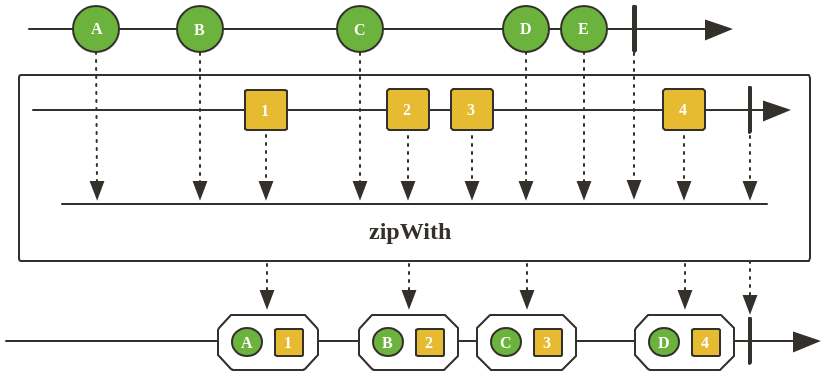
  <figcaption style="text-align: center;"><strong>zipWith()</strong> - source: <a href="https://projectreactor.io/docs/core/release/api/reactor/core/publisher/Flux.html#zipWith-org.reactivestreams.Publisher-">zipWith()</a></figcaption>
</figure>

```java
    Flux<String> letters = Flux.just("a", "b", "c");
    Flux<Integer> numbers = Flux.just(1, 2, 3);

    letters.zipWith(numbers)
           .subscribe(tuple -> System.out.println("Tuple: " + tuple));
        // Output: Tuple2{t1=a, t2=1}
        //         Tuple2{t1=b, t2=2}
        //         Tuple2{t1=c, t2=3}

    // Avec une fonction de combinaison :
    letters.zipWith(numbers, (l, n) -> l + n)
           .subscribe(System.out::println);
        // Output: a1
        //         b2
        //         c3
```

12. `doOnSubscribe(Consumer<? super Subscription> onSubscribe)` : Permet d'exécuter une action lorsque la souscription a lieu. La `Subscription` est l'objet retourné au `Subscriber` lors de l'appel à `onSubscribe` (de l'interface `Subscriber`).
<figure>
  
  <figcaption style="text-align: center;"><strong>doOnSubscribe()</strong> - source: <a href="https://projectreactor.io/docs/core/release/api/reactor/core/publisher/Mono.html#doOnSubscribe-java.util.function.Consumer-">doOnSubscribe()</a></figcaption>
</figure>

```java
    Flux.just("start").doOnSubscribe(sub -> System.out.println("Subscribed!")).subscribe(System.out::println);
```

13. `doOnComplete(Runnable onComplete)` : Permet d'exécuter une action lorsque le `Publisher` se complète avec succès (appel de `onComplete()` du `Subscriber`).
<figure>
  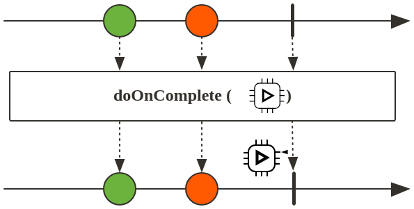
  <figcaption style="text-align: center;"><strong>doOnComplete()</strong> - source: <a href="https://projectreactor.io/docs/core/release/api/reactor/core/publisher/Flux.html#doOnComplete-java.lang.Runnable-">doOnComplete()</a></figcaption>
</figure>

```java
    Mono.just("done").doOnComplete(() -> System.out.println("Mono completed")).subscribe(System.out::println);
```

14. `doOnError(Consumer<? super Throwable> onError)` : Permet d'exécuter une action lorsqu'une erreur se produit (appel de `onError(Throwable t)` du `Subscriber`).
<figure>
  
  <figcaption style="text-align: center;"><strong>doOnError()</strong> - source: <a href="https://projectreactor.io/docs/core/release/api/reactor/core/publisher/Flux.html#doOnError-java.util.function.Consumer-">doOnError()</a></figcaption>
</figure>

```java
    Flux.error(new RuntimeException("Something went wrong")).doOnError(e -> System.err.println("Error caught!")).subscribe(null, System.err::println);
```

#### 5.3.3 Schedulers.boundedElastic & parallel, subscribeOn , publishOn

#### 5.2.3 Reactor Netty

#### 5.2.4 Reactor Kafka

## 6. Spring WebFlux

### 6.1 Architecture et principes


## 7. Persistance réactive avec R2DBC

### 7.1 Principes de R2DBC

### 7.2 Intégration avec Spring Data

## 8. POC pratique

### 8.1 Architecture de l'application

### 8.2 API réactive avec Spring WebFlux

### 8.3 Persistance avec R2DBC PostgreSQL

### 8.4 Intégration Kafka

## 9. Références