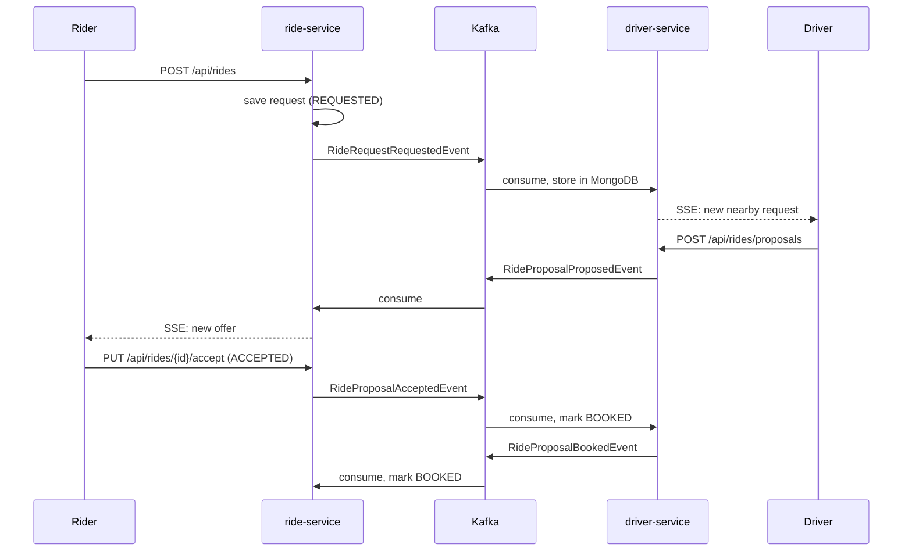

# Reactive Ride-Hailing

*English · [Français](README.fr.md)*

A ride-hailing backend built reactive end to end with Spring WebFlux, Kafka, R2DBC and MongoDB. A rider posts a ride request, nearby drivers see it in real time and send price offers, and the rider sees the offers live and accepts one.

I built it to compare the thread-per-request model with the reactive model. The full write-up on reactive programming in Java (threads, Reactive Streams, Reactor, WebFlux internals, R2DBC, Reactor Kafka) is in [GUIDE.md](GUIDE.md) ([French version](GUIDE.fr.md)).

## Architecture


| Service | Role | Storage |
| --- | --- | --- |
| api-gateway | Single entry point (port 8085), routing and authorization | – |
| auth-service | Sign-up and login, issues JWTs | PostgreSQL (R2DBC) |
| ride-service | Rider side: create requests, stream offers, accept one | PostgreSQL (R2DBC) |
| driver-service | Driver side: stream nearby requests, send offers | MongoDB (reactive) |
| common | Avro schemas and event classes shared by the services | – |

## Ride lifecycle



## Tech stack

- Java 21, Spring Boot 3.5, Spring WebFlux on Reactor Netty
- Spring Cloud Gateway (reactive), Spring Security, JWT
- PostgreSQL with Spring Data R2DBC
- MongoDB with Spring Data MongoDB Reactive: geospatial queries and change streams
- Apache Kafka (KRaft mode), Confluent Schema Registry, Avro
- Reactor Kafka, through Spring Kafka's reactive templates
- Server-Sent Events for real-time updates
- Docker Compose, AKHQ (Kafka web UI)

## Running it locally

Prerequisites: Java 21, Maven, Docker with Docker Compose.

```bash
mvn clean install -U

cd spring-webflux-poc
docker compose up -d           # PostgreSQL, MongoDB (replica set), Kafka, Schema Registry, AKHQ

cd common
mvn schema-registry:register   # registers the Avro schemas; retry after a few seconds if it fails

# then start each service in its own terminal
cd ../auth-service   && mvn spring-boot:run
cd ../ride-service   && mvn spring-boot:run
cd ../driver-service && mvn spring-boot:run
cd ../api-gateway    && mvn spring-boot:run
```

Local ports: API gateway 8085, AKHQ 9000, Schema Registry 8081, Kafka 9092, PostgreSQL 15432, MongoDB 27017.

A Postman collection is included: `spring-webflux-poc/poc-spring-webflux.postman_collection.json`.

## API

All requests go through the gateway on port 8085. Every endpoint except sign-up and login needs an `Authorization: Bearer <JWT>` header.

| Method | Path | Role | What it does |
| --- | --- | --- | --- |
| POST | `/api/users` | – | Sign up as USER or DRIVER |
| POST | `/api/users/auth` | – | Log in, returns a JWT |
| POST | `/api/rides` | USER | Create a ride request |
| GET | `/api/rides/{rideRequestId}/proposals/stream` | USER | Live stream (SSE) of driver offers |
| PUT | `/api/rides/{rideRequestId}/accept` | USER | Accept an offer |
| GET | `/api/rides/nearby/stream?lat=…&lng=…&radius=…` | DRIVER | Live stream (SSE) of nearby requests, radius in km |
| POST | `/api/rides/proposals` | DRIVER | Send a price offer |

Example: create a ride request.

```bash
curl -X POST http://localhost:8085/api/rides -H "Content-Type: application/json" -H "Authorization: Bearer YOUR_JWT_TOKEN" -d '{"startLng": 20.2, "startLat": 33.2, "endLng": 20.1, "endLat": 50.1, "seats": 2, "preferredPrice": 12.22}'
```

More curl examples are in [GUIDE.md, section 8.5](GUIDE.md#85-api-endpoints).

## Design choices

- **Reactive end to end.** One blocking call on a Netty event loop stalls every connection that loop serves, so every I/O goes through a non-blocking driver: R2DBC for PostgreSQL, the reactive MongoDB driver, and Reactor Kafka.
- **Nearby requests = history + live feed.** driver-service first returns matching requests with a geospatial query, then follows new ones through a MongoDB change stream, and joins the two with `Flux.concat`. Change streams need a replica set, which is why Docker Compose starts MongoDB as a single-node replica set.
- **Typed events.** Kafka events are Avro records registered in Schema Registry, generated in the `common` module and shared by all services.
- **Each service owns its data.** ride-service keeps the rider's view in PostgreSQL; driver-service keeps its own copy in MongoDB, where geo queries and change streams are built in.

## TODO

- [ ] **Make database and Kafka writes atomic.** Services save to the database, then publish to Kafka. `@Transactional` only covers the database, so a crash or a Kafka error between the two steps loses the event. Plan: transactional outbox pattern.
- [ ] **Acknowledge offsets after the follow-up event is sent.** In driver-service's `RideProposalAcceptedEventConsumer`, the offset is acknowledged before the "booked" event is published. Also log requests or offers that are not found and route them to a dead-letter topic instead of skipping them silently.
- [ ] **Add error recovery to the driver-service consumer.** It ends with a bare `subscribe()` and `KafkaFluxRegistry` only logs errors, so one exception stops consumption until restart. Plan: per-record `onErrorResume` or `retryWhen`, plus a dead-letter topic.
- [ ] **Share one change stream across drivers.** Each SSE connection opens its own MongoDB change stream. Plan: one shared stream fanned out to subscribers with `Sinks.many().multicast()`.
- [ ] **Migrate off Reactor Kafka.** The project was discontinued in May 2025 and Spring Kafka's reactive templates are deprecated ([announcement](https://spring.io/blog/2025/05/20/reactor-kafka-discontinued)). Plan: plain Spring Kafka (`KafkaTemplate`, `@KafkaListener`) bridged to `Mono`/`Flux`.
- [ ] **Add automated tests.** Integration tests with Testcontainers (Kafka, PostgreSQL, MongoDB) and `StepVerifier` for the reactive pipelines.
